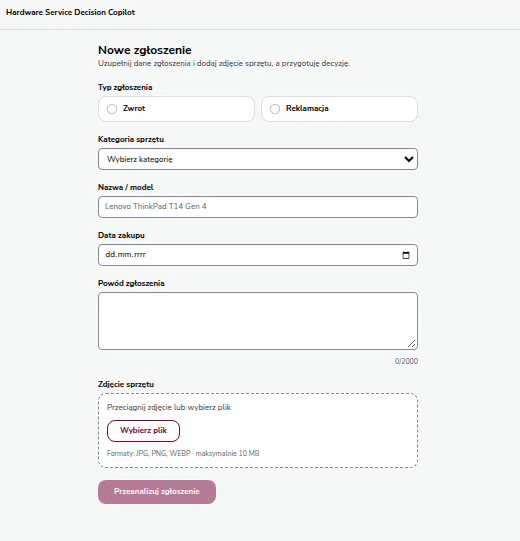
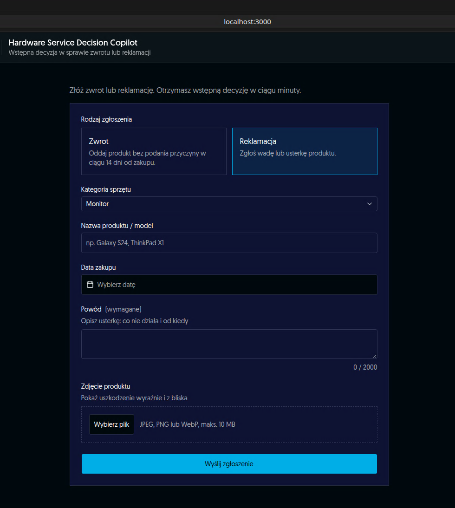
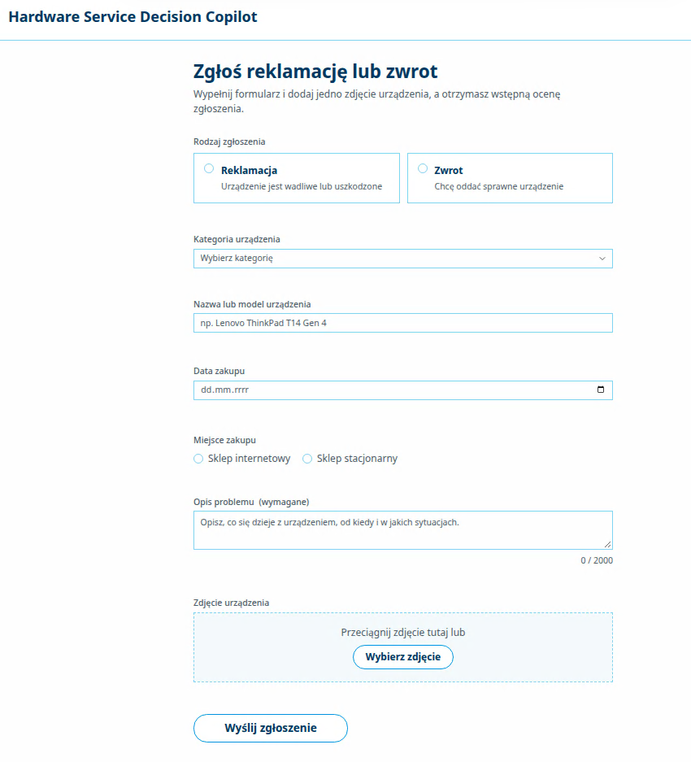
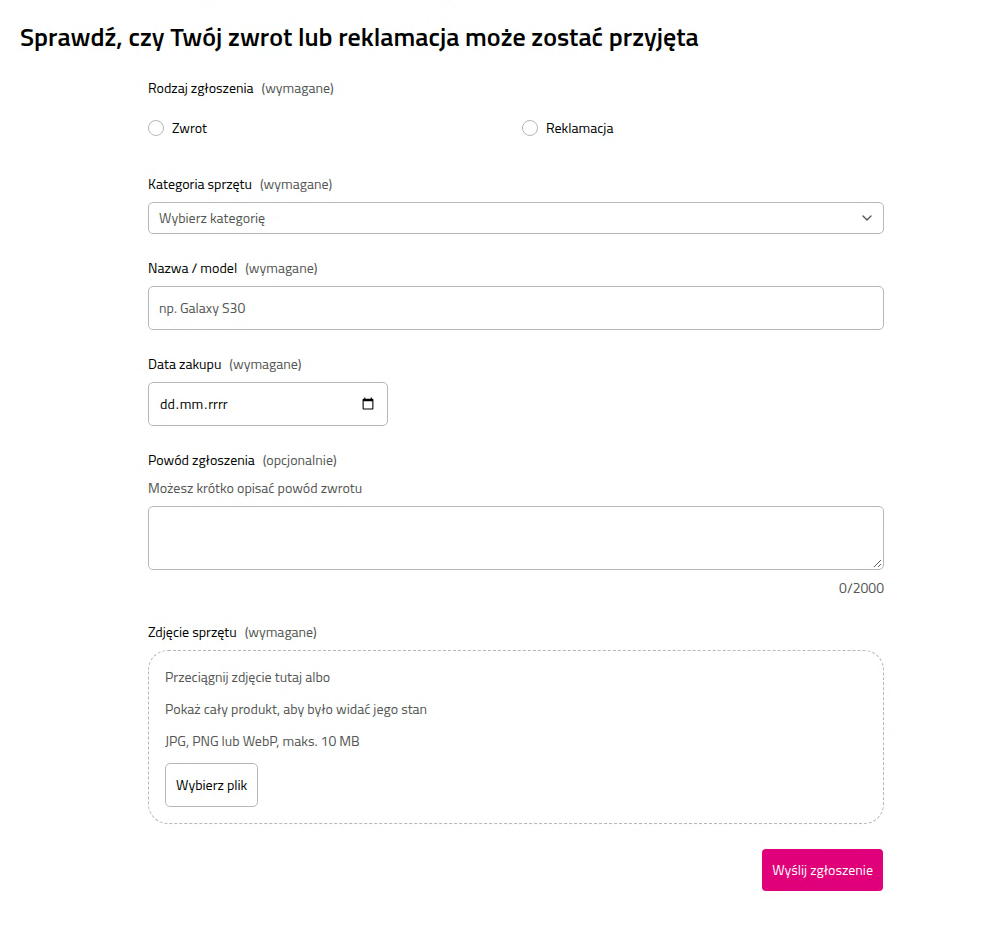

# Historia czatu — dzień 5, 27 listopada 2026

Wiadomości publiczne w kolejności chronologicznej. Reakcje oznaczają zliczenia przy wiadomościach, nie rozłączne głosy ani liczbę uczestników.

## Wiadomości

- **09:19 — Łukasz Matuszewski:** Podsumowania i wiadomości z Zoom:  
  https://github.com/LucasMatuszewski/jsystems-ai-programming-2026-11/tree/main/course-materials/zoom-summary-chat-history

- **09:19 — M.M.:** będzie dostęp do tego ograniczony czasowo?

- **09:21 — Łukasz Matuszewski:** Odpowiedzi na Wasze pytania:  
  https://devpowers.com/szkolenia/jsystems/ai-programming-2026-11/pytania.html#artefakty

- **09:22 — Łukasz Matuszewski:** Azure DevOps z agentami:  
  https://devpowers.com/szkolenia/jsystems/ai-programming-2026-11/pytania.html#azure-devops

- **09:24 — Łukasz Matuszewski:** Azure CLI i MCP:  
  https://github.com/LucasMatuszewski/jsystems-ai-programming-2026-11/tree/main/course-materials/cicd-headless/azure-devops

- **09:25 — Łukasz Matuszewski:** Code Review z GitHub Copilot na Azure:  
  https://learn.microsoft.com/en-us/azure/devops/repos/git/copilot-code-reviews?view=azure-devops

- **09:38 — Łukasz Matuszewski:** Koszty środowisk w chmurze Cloud Environments:  
  https://devpowers.com/szkolenia/jsystems/ai-programming-2026-11/pytania.html#agent-w-chmurze

- **09:39 — M.Ś.:** U mnie skończył i aplikacja działa

- **09:41 — M.S.:** u mnie skończył i aplikacja działa, screen:  
  

- **09:44 — R.K.:** U mnie również skończone i działa

- **09:44 — W.:** 

- **09:45 — W.:** u mnie też skończył, trochę słaby wzór dla design systemu wybrałem 😁  
  goal wznowił po zakończeniu limitu i teraz czekał cały czas na scalenie PR'ek, więc go zatrzymałem /goal clear

- **09:46 — R.K.:** 

- **09:49 — Łukasz Matuszewski:** Ominięcie 5h limitów aby kontynuował:  
  Uptime monitor, which resumed work here after restarting the 5-hour window at 11:15am

- **09:49 — Łukasz Matuszewski:** Ustaw monitor który wznowi twoją pracę co 5h i 30m

- **09:52 — G.:** 

- **10:01 — Łukasz Matuszewski:** Check if the development server is running, and I would like you to show me the page with our application in Claude's built-in browser.

- **10:04 — Łukasz Matuszewski:** /goal clear  
  usunięcie celu

- **10:14 — Łukasz Matuszewski:** Code Review w GH Workflow z PR Agent (open Source)  
  https://github.com/LucasMatuszewski/jsystems-ai-programming-2026-11/blob/feat/app-implementation/.github/workflows/pr-agent-azure-review.yml

- **10:16 — Łukasz Matuszewski:** PR Agent do CR na dowolnej platformie:  
  https://github.com/The-PR-Agent/pr-agent

- **10:20 — Łukasz Matuszewski:** openai/gpt-6.2-sol

- **10:21 — Łukasz Matuszewski:** openai/gpt-6-luna

- **10:25 — Łukasz Matuszewski:** pull changes here from the main branch and create a new branch from it with the name Code Review Agents.

- **10:31 — Łukasz Matuszewski:** do 10:40 zadanie:  
  modyfikacje GH Workflow aby działał z OpenRouter Endpoint  
  Model: openai/gpt-6-luna  
  API Key ten same który macie w .env ustawcie w sekretach  
  Poproście aby agent Was pokierował jak to zrobić po stronie GitHub

- **10:41 — Łukasz Matuszewski:** `https://github.com/<USER_NAME>/jsystems-ai-programming-2026-11/settings/secrets/actions`

- **10:44 — Łukasz Matuszewski:** OPENROUTER_API_KEY

- **10:47 — Łukasz Matuszewski:** PR_AGENT_MAX_TOKENS

- **10:55 — Łukasz Matuszewski:** Dodajmy workflows do PAT w GH:  
  https://github.com/settings/personal-access-tokens

- **10:56 — Łukasz Matuszewski:** Workflows  
  Update GitHub Action workflow files

- **10:56 — Łukasz Matuszewski:** I have added the workflows permission to PAT

- **10:59 — Łukasz Matuszewski:** PR ze zmianą dla PR Agent i dodanym komentarzem:  
  https://github.com/LucasMatuszewski/jsystems-ai-programming-2026-11/pull/49

- **11:02 — Łukasz Matuszewski:** Komercyjne platformy do PR i Code Review:  
  https://www.qodo.ai/  
  https://www.coderabbit.ai/

- **11:03 — Łukasz Matuszewski:** Do security aplikacji w CI/CD m.in. jest Snyk  
  https://snyk.io/

- **11:05 — Łukasz Matuszewski:** I'm also adding a new workflow now in which we will run the tests we have here for this application, also using our OpenRouter, which is already set as a secret.  
  OPENROUTER_API_KEY  
  Check if something else we should add to Variables or Secrets.

- **11:06 — Łukasz Matuszewski:** Gotowe przykłady dla Ci/CD różnych platform z różnymi agentami:  
  https://github.com/LucasMatuszewski/jsystems-ai-programming-2026-11/tree/main/course-materials/cicd-headless

- **11:12 — Łukasz Matuszewski:** Przykłady z Claude headless w GitHub z kluczem na rok z subskrypcji:  
  https://github.com/LucasMatuszewski/jsystems-ai-programming-2026-11/blob/main/course-materials/cicd-headless/scripts/claude_pr_review.sh

- **11:13 — Łukasz Matuszewski:** Przerwa do 11:30

- **11:41 — Łukasz Matuszewski:** wygenerowanie tokenu API key z Claude long-lived token do automatyzacji i CI/CD:  
  https://github.com/LucasMatuszewski/jsystems-ai-programming-2026-11/blob/main/course-materials/Research/automation-tokens-mcp-news-ide-acp-2026-11-26.md#1-long-lived-automation-tokens

- **11:44 — Łukasz Matuszewski:** Yes, configure Claude Code headless mode GH Workflow. Here are some sources and examples:  
  course-materials/Research/automation-tokens-mcp-news-ide-acp-2026-11-26.md  
  course-materials/cicd-headless/scripts/claude_pr_review.sh  
  more examples: course-materials/cicd-headless  
  Pls configure a simple workflow for Claude headless so we can see that it works, but also guide me on what I have to do here. For example, we need to generate this long-lived access token, set it as an environment variable, and use this variable so that the Claude CLI can access it during work.

- **11:47 — Łukasz Matuszewski:** claude setup-token

- **11:52 — Łukasz Matuszewski:** CLAUDE_CODE_OAUTH_TOKEN

- **12:04 — Łukasz Matuszewski:** https://claude.ai/settings/claude-code

- **12:04 — Łukasz Matuszewski:** https://claude.ai/new#settings/claude-code

- **12:10 — Łukasz Matuszewski:** Personalizacja na poziomie całego konta użytkownika - w chmurze i lokalnie:  
  https://claude.ai/new#settings/personalization

- **12:12 — Łukasz Matuszewski:** PRZYKŁAD INSTRUKCJI GLOBALNYCH USERA:  
  Mów swobodnie, bez formalnego tonu, ale zachowując profesjonalizm.  
  Pisz zwięźle! Odpowiadaj krótko, chyba że poproszę o więcej szczegółów. Preferuję instrukcje krok po kroku, konkretne i pozbawione zbędnych wyjaśnień. Nigdy nie powtarzaj tych samych informacji.  
  Możesz wyrażać własne opinie na różne tematy, ale zawsze wyraźnie zaznaczaj, że to Twoja opinia, a nie fakt. Jeśli czegoś nie wiesz, po prostu powiedz, że nie wiesz.  
  W rozmowach głosowych na żywo używaj wobec siebie form żeńskich. W rozmowach tekstowych używaj form męskich. Stosuj tę zasadę w każdym języku, również w angielskim, wszędzie tam, gdzie występuje rozróżnienie rodzaju gramatycznego.

- **12:15 — Łukasz Matuszewski:** Do oszczędzania tokenów Skills:  
  https://github.com/JuliusBrussee/caveman/tree/main  
  https://github.com/JuliusBrussee/caveman/blob/main/skills/caveman/SKILL.md

- **12:20 — Łukasz Matuszewski:** Ponytail - lazy developer:  
  https://github.com/DietrichGebert/ponytail/tree/main

- **12:21 — Łukasz Matuszewski:** https://github.com/DietrichGebert/ponytail/blob/main/skills/ponytail/SKILL.md

- **12:32 — Łukasz Matuszewski:** Claude Hooks:  
  https://code.claude.com/docs/en/hooks

- **12:43 — Łukasz Matuszewski:** I noticed that every time I work with Fable, it doesn't answer my questions right away, but it can work for a very long time without writing to me at all. So I would like to add a custom prompt here and detect when I send prompts that use the Fable model. If Fable is being used, I would like to attach detailed instructions just for Fable to make it, for example, first give me an answer. It should describe its implementation plan, and only then start acting. While it's working, it should report its progress on an ongoing basis, rather than waiting until the very end. It should inform me from time to time about the work's progress and use tasks so I can see, for example, how those tasks are progressing, and so on. I tried to do it with a regular instruction, asking him at the start of the session, but it didn't work. It still worked for him, so let's strengthen this instruction in the prompt a lot, so he has to do it. It must be mandatory every time he works.

- **12:46 — Łukasz Matuszewski:** Przykłady z Hooks dla różnych agentów:  
  https://github.com/LucasMatuszewski/jsystems-ai-programming-2026-11/tree/main/course-materials/hooks-example

- **12:51 — Łukasz Matuszewski:**

  ```json
  "PostModelSwitch": [
        {
          "hooks": [
            {
              "type": "command",
              "command": "python3 -I \"$CLAUDE_PROJECT_DIR\"/.claude/hooks/fable_guard.py model-switch || true",
              "timeout": 10
            }
          ]
        }
      ],
  ```

- **12:53 — Łukasz Matuszewski:** It seems to me that you've overcombined things here and added too much, because I'm afraid that this will also affect performance. I also don't want Opus to duplicate these instructions when talking to Fable. They should only be duplicated when I talk to Fable directly. So maybe the Postmodel Switch event would be best when I manually switch to Fable. And the question is: can't we add some matches there so that this script command isn't deactivated if a match isn't found? At this point, you've made it so that this Python script is deactivated every time. Maybe we can use an if statement at the hook level to filter this data.

- **12:54 — Łukasz Matuszewski:** Przykładowy hook dla odpalenia agenta z review zmian w dependencjach dla pom.xml  
  https://github.com/LucasMatuszewski/jsystems-ai-programming-2026-11/blob/main/.claude/settings.json#L132

- **13:02 — Łukasz Matuszewski:**

  ```json
  "Bash(node:*)",
        "Bash(python:*)",
        "Bash(python3:*)",
  ```
  These 3 commands here with allow should be removed. They are very dangerous because they actually allow you to use any Node and Python script without scanning by Auto mode.

- **13:05 — Łukasz Matuszewski:** Koniec przerwy 13:35

- **13:05 — Łukasz Matuszewski:** Docs Permissions:  
  https://code.claude.com/docs/en/permissions

- **13:08 — Łukasz Matuszewski:** Koniec przerwy 13:35

- **13:08 — Łukasz Matuszewski:** Codex Permissions:  
  https://learn.chatgpt.com/docs/permissions

- **13:09 — Łukasz Matuszewski:** Codex rules aby pozwolić na wychodzenie z Sandbox  
  RULES CODEX INACZEJ DZIAŁAJĄ NIŻ W CLAUDE CODE!!!  
  https://learn.chatgpt.com/docs/agent-configuration/rules

- **13:40 — Łukasz Matuszewski:** Rules w Claude to instrukcje targetowane na path:  
  https://code.claude.com/docs/en/memory#path-specific-rules

- **13:45 — Łukasz Matuszewski:** Codex odpowiednik Auto Mode:  
  https://learn.chatgpt.com/docs/sandboxing/auto-review

- **13:45 — Łukasz Matuszewski:** Codex: Approve for me f

- **13:49 — Łukasz Matuszewski:** Legacy code w Java - 14 lat, bez testów, bez dokumentacji:  
  https://github.com/sai-pullabhotla/jftp

- **13:50 — Łukasz Matuszewski:** git clone https://github.com/sai-pullabhotla/jftp.git

- **13:51 — Łukasz Matuszewski:** labuser@ai-mvp-15:~$ git clone https://github.com/sai-pullabhotla/jftp.git  
  Klonowanie do „jftp”...  
  remote: Enumerating objects: 937, done.  
  remote: Total 937 (delta 0), reused 0 (delta 0), pack-reused 937 (from 1)  
  Pobieranie obiektów: 100% (937/937), 1.39 MiB | 6.46 MiB/s, gotowe.  
  Rozwiązywanie delt: 100% (448/448), gotowe.  
  labuser@ai-mvp-15:~$ cd jftp/

- **13:51 — Łukasz Matuszewski:** npx --yes skills@latest add EdukeyTeam/agent-toolbox --skill '*'

- **13:59 — Łukasz Matuszewski:** /legacy-codebase-workflows create a repo map of the whole application we are in

- **14:01 — Łukasz Matuszewski:** ! code .

- **14:02 — Łukasz Matuszewski:** .claude/skills  
  .agents/skills  
  do .gitignore

- **14:02 — Łukasz Matuszewski:** /docs/repo-maps/artifacts/

- **14:10 — Łukasz Matuszewski:** Repo Map jest z Aider (kiedyś najlepsze narzędzie AI do programowania):  
  https://aider.chat/docs/repomap.html

- **14:11 — Łukasz Matuszewski:** RepoMix:  
  https://github.com/yamadashy/repomix

- **14:14 — Łukasz Matuszewski:** /legacy-codebase-workflows create a RepoMix with full compression without comments, and without compression without comments

- **14:20 — Łukasz Matuszewski:** /legacy-codebase-workflows create a code graph and show me in the end html with visualisation - open it in browser

- **14:21 — Łukasz Matuszewski:** Graph Kodu do pokazania powiązań:  
  https://github.com/Graphify-Labs/graphify

- **14:26 — Łukasz Matuszewski:** @/home/labuser/Obrazy/

- **14:29 — Łukasz Matuszewski:** You created a graph in which there are no described communities, so I would like you to improve it by analyzing the repo map, the graph itself, and all the other tools that we have created so far, so that you can describe these communities properly and make them more readable for me.

- **14:29 — Łukasz Matuszewski:** Terminale bardziej zaawansowane:  
  https://wezterm.org/install/windows.html#installing-on-windows

- **14:30 — Łukasz Matuszewski:** https://ghostty.org/  
  Mac i Linux

- **14:31 — Łukasz Matuszewski:** Windows Terminal:  
  https://apps.microsoft.com/detail/9n0dx20hk701

- **14:33 — Łukasz Matuszewski:** Rex CLI  
  https://www.mindstudio.ai/blog/rex-terminal-mitchell-hashimoto  
  https://www.superlogical.com/rex/docs/automate/cli

- **14:37 — Łukasz Matuszewski:** /legacy-codebase-workflows create custom context7 with local RAG on codebase to let agents search locally

- **14:39 — Łukasz Matuszewski:** point 1, but add also info about RepoMap, RepoMix and Graph. Only simple info for now.

- **14:41 — Łukasz Matuszewski:** Answered Claude's questions:  
  · May I create AGENTS.md (the repo has none) with a short local-Context7 retrieval block? I can also add pointers to the repo map, Repomix packs and code-graph guide we built (the proposal still open from earlier). Claude would read it via a CLAUDE.md containing only @AGENTS.md. → point 1, but add also info about RepoMap, RepoMix and Graph. Only simple info for now.  
  · May I add automatic index-refresh hooks to .claude/settings.json? They're PostToolUse on edit/write/shell tools plus Stop, and they run only the pinned local refresh handler. → Yes, add hooks (Recommended)  
  · Which search engine should the index use? → Local semantic + lexical (Recommended)  
  · Which agents should get the context7-local MCP server registered? → Claude Code

- **14:43 — Łukasz Matuszewski:** Lokalny RAG z Context7 w moim skill:  
  https://github.com/EdukeyTeam/agent-toolbox/tree/main/skills/legacy-codebase-workflows/assets/context7  
  Private Retrieval RAG  
  https://github.com/EdukeyTeam/agent-toolbox/blob/main/skills/legacy-codebase-workflows/references/private-retrieval.md

- **14:43 — Łukasz Matuszewski:** https://github.com/EdukeyTeam/agent-toolbox/blob/main/skills/legacy-codebase-workflows/references/local-context7-setup.md

- **14:47 — Łukasz Matuszewski:** Commit all changes in granular commits concerning the individual elements we've done so far

- **14:49 — Łukasz Matuszewski:** /write-agents-md Analyze everything that we've just done so you'll have a full overview of what's happening here in this project, and create a new AGENTS.md file in accordance with the guidelines in this skill for adding  
    AGENTS.md. Think about whether we should create some kind of a nested AGENTS.md for parts of code if necessary, but remember that they should be as small and minimalistic as possible.

- **15:01 — Łukasz Matuszewski:** claude doctor

- **15:03 — Łukasz Matuszewski:** What it does: It makes Claude read your instruction files, meaning the text that loads into Claude Code sessions: CLAUDE.md, AGENTS.md, rules, skills, custom commands and subagents. It finds stale facts, contradictions and dated wording. Then it proposes the fixes as diffs, one per finding, and you choose which ones to accept. flaviocopes  
  How to use it:  
  Update Claude Code first, since it needs version 2.1.283 or later: flaviocopes  
  claude update  
  Inside a session, audit everything in the project:  
  /doctor prompt-audit  
  Or check only one file or folder by passing its path:  
  /doctor prompt-audit AGENTS.md

- **15:04 — Łukasz Matuszewski:** /doctor prompt-audit AGENTS.md

- **15:05 — Łukasz Matuszewski:** /cd ../jftp/

- **15:05 — Łukasz Matuszewski:** /cd /home/labuser/jftp/

- **15:07 — Łukasz Matuszewski:** /legacy-codebase-workflows create architecture docs with Mermaid UML with the skill recommended in our legacy skill, use also the icons to make it more visual

- **15:09 — Łukasz Matuszewski:** Skill którego używa wewnętrznie mój skill:  
  https://github.com/SpillwaveSolutions/design-doc-mermaid

- **15:11 — Łukasz Matuszewski:** /claude-api prompt-audit AGENTS.md

- **15:16 — Łukasz Matuszewski:** nerd fonts jetbrains mono  
  Czcionka nowoczesna z ikonami itp.

- **15:17 — Łukasz Matuszewski:** https://www.nerdfonts.com/font-downloads

- **15:18 — Łukasz Matuszewski:** lepszy ls / tree  
  https://github.com/eza-community/eza

- **15:24 — Łukasz Matuszewski:** /legacy-codebase-workflows Do basic tests that will keep an eye on the most important elements of this application before we do any refactor: regression tests characterizing them. Then I will prepare some minor possible changes to start this application and open it here on this device. Namely, at the very beginning, with the committee, and here, changes related to the architecture in one committee, so that it's already.

- **15:26 — Łukasz Matuszewski:** Koniec przerwy 15:31

- **15:40 — Łukasz Matuszewski:** Przykładowy connector dla Azure:  
  https://claude.ai/directory/ant.dir.gh.microsoft.mcp-win-x64

- **15:46 — Łukasz Matuszewski:** Code Review  
  https://claude.com/resources/articles/code-review-is-now-generally-available

- **15:52 — Łukasz Matuszewski:** Codex Code Review:  
  https://chatgpt.com/codex/cloud/settings/code-review

- **15:52 — Łukasz Matuszewski:** https://docs.github.com/en/copilot/how-tos/copilot-on-github/customize-copilot/add-custom-instructions/add-repository-instructions

- **15:53 — Łukasz Matuszewski:** https://claude.com/resources/articles/introducing-claude-ship

- **15:56 — Łukasz Matuszewski:** Checklisty po szkoleniu:  
  https://devpowers.com/szkolenia/jsystems/ai-programming-2026-11/checklisty.html#harness

- **15:57 — Łukasz Matuszewski:** https://ankiety.jsystems.pl/

- **15:58 — M.M.:** pokaz jeszcze liste id uczestników

- **15:59 — M.M.:** nie ty jedyny :)

- **16:00 — Łukasz Matuszewski:** Osoby do śledzenia:  
  https://github.com/LucasMatuszewski/jsystems-ai-programming-2026-11/blob/main/course-materials/Course%20INDEX%20-%20AI%20in%20Programming.md#people-and-accounts-to-follow-in-ai

- **16:02 — Łukasz Matuszewski:** Więcej Generalistów, mniej ekspertów:  
  https://devpowers.com/szkolenia/jsystems/ai-programming-2026-11/Prezentacja_02_Podstawy_AI.html#11

- **16:05 — Łukasz Matuszewski:** Narzędzia do zarządzania wieloma agentami:  
  https://github.com/LucasMatuszewski/jsystems-ai-programming-2026-11/blob/main/course-materials/Research/agent-managers-and-remote-agents.md

- **16:15 — Łukasz Matuszewski:** https://devpowers.com/szkolenia/jsystems/ai-programming-2026-11/index.html

- **16:16 — Łukasz Matuszewski:** https://openai.com/pl-PL/index/hugging-face-incident-and-the-road-ahead/

- **16:16 — R.K.:** Jest nawet dokument na netflixie o tym incydencie

- **16:17 — Łukasz Matuszewski:** Wywiad Aleksander Mądry z OpenAI o bezpieczeństwie  
  https://www.youtube.com/watch?v=qaT3MXdBXDo

- **16:18 — Łukasz Matuszewski:** Instadocs: AI Gone Wild  
  https://www.netflix.com/pt-en/title/82772145

- **16:19 — Łukasz Matuszewski:** Headless mode:  
  https://github.com/LucasMatuszewski/jsystems-ai-programming-2026-11/blob/main/course-materials/Research/Headless%20agents%20-%20CLI%20automation%2C%20JSON%20streaming%2C%20subscriptions%20and%20CI-CD.md

- **16:20 — P.T.:** Dzięki za szkolenie!!

- **16:20 — E.2:** dzięki!

- **16:20 — B.:** Dziękuję

- **16:20 — M.:** Dzięki!

- **16:20 — E.:** Dzięki!

- **16:22 — Łukasz Matuszewski:** https://v0.app/templates

- **16:23 — Łukasz Matuszewski:** https://lovable.dev/dashboard

- **16:23 — Łukasz Matuszewski:** https://bolt.new/

- **16:23 — Łukasz Matuszewski:** https://replit.com/

- **16:24 — Łukasz Matuszewski:** https://www.skills.sh/anthropics/skills/frontend-design  
  Skills popularne = generyczne strony podobne

- **16:26 — Łukasz Matuszewski:** Do designu warto sprawdzić mniej popularne modele - będą budować strony inaczej wyglądające.  
  Np. GLM  
  https://z.ai/blog/glm-5.3

- **16:26 — Łukasz Matuszewski:** https://z.ai/chat

- **16:26 — Łukasz Matuszewski:** https://z.ai/subscribe

- **16:27 — Łukasz Matuszewski:** Gotowe komponenty popularne dla agentów:  
  https://ui.shadcn.com/

- **16:28 — Łukasz Matuszewski:** https://vercel.com/academy/ai-sdk/ai-elements  
  oparty ostatnio o Shadcn

- **16:30 — Łukasz Matuszewski:** https://www.behance.net/galleries/ui-ux  
  Wzorowanie na najlepszych

- **16:32 — Łukasz Matuszewski:** Co dalej:  
  Checklista: https://devpowers.com/szkolenia/jsystems/ai-programming-2026-11/checklisty.html#harness  
  Kogo śledzić: https://github.com/LucasMatuszewski/jsystems-ai-programming-2026-11/blob/main/course-materials/Course%20INDEX%20-%20AI%20in%20Programming.md#people-and-accounts-to-follow-in-ai

- **16:32 — Łukasz Matuszewski:** https://www.youtube.com/@theo

- **16:35 — Łukasz Matuszewski:** https://www.youtube.com/@NateBJones

- **16:35 — Łukasz Matuszewski:** https://www.youtube.com/@mattpocockuk

- **16:35 — Łukasz Matuszewski:** Security i AI  
  https://www.youtube.com/@MateuszChrobok

- **16:38 — Łukasz Matuszewski:** Claude Academy  
  https://academy.claude.com/

- **16:39 — Łukasz Matuszewski:** https://openclaw.ai/  
  Autonomiczny agent

- **16:40 — Łukasz Matuszewski:** Hermes agent trochę łatwiejszy  
  https://hermes-agent.nousresearch.com/

- **16:40 — Łukasz Matuszewski:** https://docs.openclaw.ai/

- **16:41 — G.:** dzięki, cześć

- **16:45 — Łukasz Matuszewski:** Synchronizacja plików:  
  https://syncthing.net/

- **16:46 — Łukasz Matuszewski:** https://obsidian.md/  
  Notatki w Markdown

- **16:49 — Łukasz Matuszewski:** Anthropic nowy version control zamiast GIT  
  https://www.anthropic.com/research/redesigning-source-control
