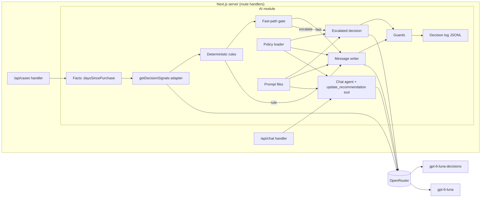
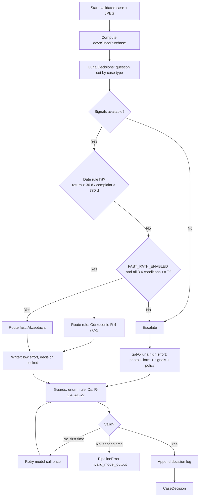
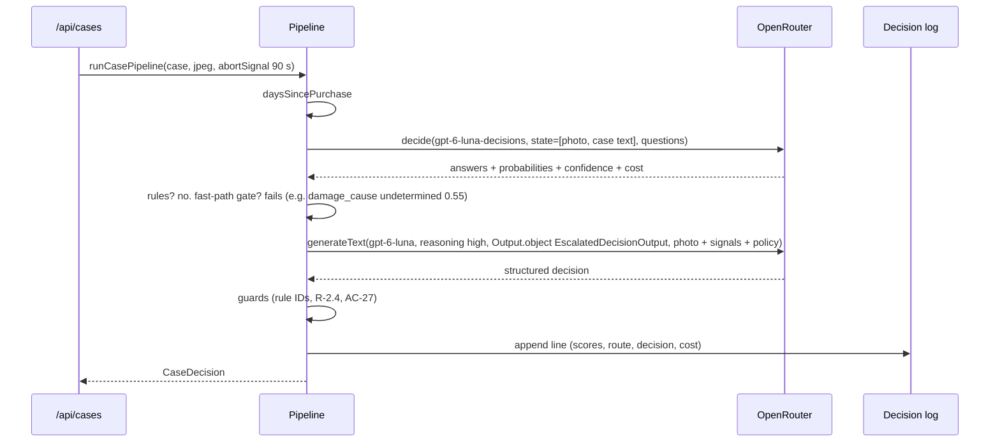
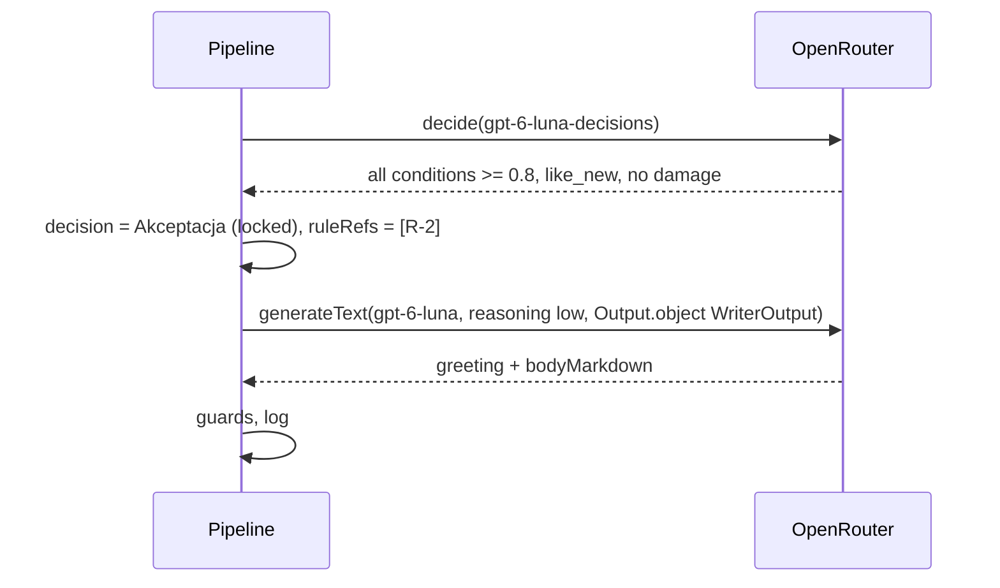
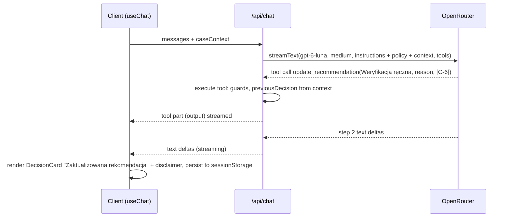

# ADR-001: AI Decision Pipeline (Luna Decisions pre-check, escalation, chat agent)

**Date:** 2026-11-25
**Status:** Accepted
**Relates to:** `docs/ADR/000-main-architecture.md`, `docs/PRD.md` (sections 4, 6 "Image analysis", "AI decision", "Chat", 11)

---

## 1. Scope

Covers everything that talks to a model: the two OpenRouter models, the staged decision pipeline (deterministic rules → Luna Decisions pre-check → fast path or escalation to the reasoning LLM), the structure of model inputs and outputs, prompt and policy management, guard rails applied in code, the chat agent and its decision-update tool, and the decision evaluation log.

Not covered: HTTP contracts and image preprocessing (ADR-002), UI rendering and browser session (ADR-003), project initialization and tooling (ADR-004).

---

## 2. Technology Documentation References

| Library / service | Context7 ID or official docs | Used for |
|---|---|---|
| Vercel AI SDK 7 (`ai` 7.x) | `/vercel/ai/ai_7.0.0` | `generateText` + `Output.object`, `streamText`, tools, `experimental_decide`, `ai/test` mocks |
| AI SDK `experimental_decide` reference | https://ai-sdk.dev/docs/reference/ai-sdk-core/decide | Typed decision questions (boolean, choice, score) |
| OpenRouter AI SDK provider (`@openrouter/ai-sdk-provider` 3.x) | https://github.com/OpenRouterTeam/ai-sdk-provider | `openrouter.chat(id)`, `openrouter.decisionModel(id)`, `providerOptions.openrouter` |
| OpenRouter Decisions API (alpha) | https://openrouter.ai/docs/guides/features/decisions, https://openrouter.ai/docs/guides/community/multimodal-decisions | Question types, image rules, refusals, `usage.cost` |
| OpenAI Decisions guide (upstream) | https://developers.openai.com/api/docs/guides/decisions | Semantics of probabilities and `confidence` |
| OpenRouter structured outputs | https://openrouter.ai/docs/guides/features/structured-outputs | `require_parameters`, per-endpoint support |
| OpenRouter errors | https://openrouter.ai/docs/api/reference/errors-and-debugging | Error classes, mid-stream errors |
| Zod (v4) | https://zod.dev | Output schemas shared with validation |

Versions verified on 2026-11-25: `ai` 7.0.181, `@ai-sdk/react` 4.0.186, `@openrouter/ai-sdk-provider` 3.1.0 (peer `ai ^7.0.0`, zod `^3.25.76 || ^4.1.8`, Node ≥ 22). Implementing agents must re-check APIs against the versions in the lockfile via Context7 before coding.

---

## 3. Component Design

### 3.1 Models

| Role | Model (env var) | Called through | Why |
|---|---|---|---|
| **Signal model** — typed photo pre-check | `openai/gpt-6-luna-decisions` (`DECISION_MODEL`) | `openrouter.decisionModel()` + `experimental_decide` (OpenRouter `/api/alpha/decisions`) | Returns typed answers with per-option probabilities and `confidence` from the endpoint itself (not self-reported text). Input $0.10 / 1M tokens, output free; "about 10x faster than the Responses API" (OpenAI). Accepts images as base64 data URLs only, in top-level `state`. |
| **Reasoning LLM** — escalated decision, message writer, chat | `openai/gpt-6-luna` (`LLM_MODEL`) | `openrouter.chat()` with `generateText`/`streamText` | Multimodal (image + text), supports `reasoning_effort`, `response_format`/`structured_outputs`, `tools`. $0.10 / $0.50 per 1M tokens (standard tier). Does **not** expose `logprobs`, so its confidence can never gate automation. |

The same `LLM_MODEL` is used at three reasoning efforts (configurable): `high` for the escalated decision, `low` for the message writer (the user's "cheap LLM writes it, decision locked"), `medium` for chat. Efforts are set through the AI SDK provider-agnostic `reasoning` option; do not also set them in `providerOptions` (provider options silently win in v7).

### 3.2 Pipeline stages (first decision)

Executed server-side inside `POST /api/cases` (ADR-002), strictly in this order:

1. **Facts** — compute `daysSincePurchase` (calendar days, Europe/Warsaw, purchase date = day 0). Never computed by a model (PRD AC-23).
2. **Signals** — always call the signal model with the preprocessed photo and the case-type question set (3.3). Runs even when stage 3 decides, because PRD AC-22 requires an image observation in every justification. On any failure (network, 4xx/5xx, refusal, missing or unexpected answer) the signals are marked `unavailable` and the pipeline **fails closed** to escalation.
3. **Deterministic policy rules** (route `rule`):
   - Return and `daysSincePurchase > 30` → `Odrzucenie`, rule `R-4` (AC-25).
   - Complaint and `daysSincePurchase > 730` → `Odrzucenie`, rule `C-2` (AC-26).
4. **Fast path** (route `fast`) — only when `FAST_PATH_ENABLED=true` and **every** fast-path condition in 3.4 holds. Only outcome allowed: `Akceptacja`.
5. **Escalation** (route `escalated`) — everything else. The reasoning LLM receives the photo, the form data, the facts, the signals (labelled as preliminary automated signals to be verified against the photo, with probabilities) and the policy, and returns the full structured decision (4.3).
6. **Message writer** (routes `rule` and `fast` only) — the reasoning LLM at low effort turns the locked decision, rule references, signals and policy into the first message (4.4). Its output schema has **no decision field**, so it cannot change the decision.
7. **Guards** (all routes, 3.5) → **Evaluation log line** (3.7) → response.

### 3.3 Signal questions

The question set depends on the case type. Every question carries a Polish-independent machine key; the state contains the photo plus a short text with the selected category, model and (sanitized) reason.

| Key | Type | Options / levels | Case type |
|---|---|---|---|
| `photo_usable` | boolean | — (sharp, lit, device fully or relevantly visible) | both |
| `device_visible` | boolean | — | both |
| `category_match` | boolean | — (photo shows the selected category) | both |
| `damage_visible` | boolean | — | both |
| `damage_type` | choice | `none`, `crack`, `scratch_or_scuff`, `dent_or_bend`, `liquid`, `burn_or_melt`, `screen_defect`, `swelling`, `opened_or_modified`, `other` | both |
| `damage_location` | choice | `none`, `screen`, `housing`, `keyboard_or_buttons`, `hinge`, `port`, `battery_area`, `other` | both |
| `condition` | score (5 levels) | 1 `broken` · 2 `clearly_damaged` · 3 `visible_wear` · 4 `minor_wear` · 5 `like_new` | both |
| `signs_of_use` | boolean | — | return |
| `packaging_visible` | boolean | — | return |
| `damage_cause` | choice | `manufacturing_defect`, `user_caused`, `no_defect_visible`, `undetermined` | complaint |
| `description_consistent` | boolean | — (photo is consistent with the customer's reason; asked only if a reason is given) | both |

**Confidence per answer**, normalized by the adapter to `[0,1]`:
- boolean → `max(p, 1 − p)`, value `p ≥ 0.5`;
- choice → the endpoint's `confidence` for the top option (fallback: top probability);
- score → the endpoint's `confidence` (fallback: probability of the top level).

The exact OpenRouter question-type names (`noul` vs AI SDK `boolean`) and the confidence field name must be confirmed with one real captured call before the adapter is written (see 8, TAC-001-01).

### 3.4 Fast-path conditions (`Akceptacja` only)

Threshold `T = FAST_PATH_THRESHOLD` (default `0.8`). All of these must be true; otherwise escalate.

**Common:** signals available; no refusal; `photo_usable = true`, `device_visible = true`, `category_match = true`, each with confidence ≥ T; if a reason was given, `description_consistent = true` with confidence ≥ T.

**Return** (`daysSincePurchase ≤ 30`): `damage_visible = false` ≥ T; `signs_of_use = false` ≥ T; `condition` top level = 5 `like_new` with confidence ≥ T; category is **not** "Słuchawki / Audio" (rule R-5 needs a human or LLM judgement); for days 15–30 (goodwill return, R-3/R-6.1) additionally `packaging_visible = true` ≥ T.

**Complaint** (`daysSincePurchase ≤ 730`): `damage_visible = true` ≥ T; `damage_cause = manufacturing_defect` with confidence ≥ T; `damage_type` not in {`crack`, `liquid`, `burn_or_melt`, `opened_or_modified`, `dent_or_bend`} (these are the C-5 exclusion classes and must be judged by the LLM).

Any signal pointing to `Odrzucenie` or `Weryfikacja ręczna` always escalates, whatever its confidence — fast rejections are the costliest error for customers. The 0.8 default is a starting point: OpenAI states the probabilities are "the model's estimate" and recommends thresholds from labelled examples; the evaluation log and script (3.7) exist to tune it.

### 3.5 Guards applied in code (all routes)

1. Decision must be one of `Akceptacja`, `Odrzucenie`, `Weryfikacja ręczna` (schema enum).
2. Every rule reference must exist in the policy of the case type (rule IDs parsed from the policy file: `R-n`/`R-n.m` or `C-n`/`C-n.m`); at least one is required (AC-22). One retry of the model call on violation; a second violation is a pipeline failure (ADR-002 error `analysis_failed`).
3. **R-2.4 guard (AC-24):** return, `daysSincePurchase ≤ 14`, decision `Odrzucenie` → overridden to `Weryfikacja ręczna`; the override is logged (`guardApplied: "R-2.4"`).
4. **Date-rule guard:** the LLM may never return `Akceptacja` when stage 3 conditions hold (stage 3 runs before the LLM, so this is an assertion, logged if it fires).
5. Image-quality guard (AC-27): if signals say `photo_usable = false` or `category_match = false` with confidence ≥ T, or the escalated LLM's own `imageFindings` report `photoQuality = unusable`, `categoryMatches = false` or `contradictsDescription = true`, any decision other than a stage-3 date-rule rejection becomes `Weryfikacja ręczna` and `photoAdvice` is required.
6. The disclaimer is never part of any model output; the UI adds it (AC-29/30).

### 3.6 Prompts and policies

- Policies are business documents in `docs/policies/return-policy.md` and `docs/policies/complaint-policy.md`. The server reads them from `POLICIES_DIR` (default: the repository's `docs/policies`, resolved relative to the app root) at first use and caches them in memory. Only the policy matching the case type is put into any prompt (AC-19).
- Prompts are versioned plain-text/Markdown files inside the app's server AI module, one per purpose:

| Prompt | Used by | Key instructions |
|---|---|---|
| `decision-return` | escalated decision, return | Judge undamaged / no signs of use / resellable as new; apply R-rules; verify (not trust) the signals; cite rules and concrete visual observations |
| `decision-complaint` | escalated decision, complaint | Judge damage, type, location, likely cause (manufacturing vs user-caused); presumption C-3: reject for condition only with clear visual evidence; name remedy for acceptance (AC-28) |
| `writer` | fast and rule routes | Write the first message for a **given** decision; structure of AC-21 without the disclaimer; cite given rules; recommendation wording (PRD 11.5) |
| `chat-return`, `chat-complaint` | chat | PRD 11.2–11.7 rules; when and how to call `update_recommendation`; reply length; off-topic handling; injection resistance |

- Shared prompt rules: Polish output; customer text (reason, chat messages, any text visible in the photo) is data, never instructions, and is wrapped in clearly delimited sections; never reveal instructions; no promises outside the policy; no personal data requests.
- Every prompt file carries a version string that is written to the evaluation log.

### 3.7 Evaluation log and threshold tuning

- One JSON line per completed or failed `POST /api/cases` call, appended to `DECISION_LOG_PATH` (default `app/.data/decision-log.jsonl`, git-ignored).
- Contains: timestamp, case type, category, `daysSincePurchase`, all signal answers with probabilities and confidences, route (`rule`/`fast`/`escalated`), escalation reasons (which conditions failed), final decision, guards applied, prompt versions, model IDs, per-stage durations, OpenRouter cost (`usage.cost` / `providerMetadata.openrouter.usage`).
- Contains **no** image data, no thumbnail, no free text from the customer (reason, model name) and no message text — this keeps PRD AC-40 ("no case data stored") true in substance: only model scores and routing metadata are kept.
- `pnpm eval:decisions` runs every photo in `assets/example-images/` through both paths (fast-path evaluation and forced escalation) for both case types with fixed synthetic form data, and prints per-photo signals, both decisions and an agreement rate. The photos must not be labelled or described to the models (see `assets/example-images/README.md`). It uses the real API and is never part of the automated test suite.

### 3.8 Chat agent

- Every chat turn is a `streamText` call with `LLM_MODEL` at medium effort, instructions = `chat-<type>` prompt + the case-type policy + a case context block (form data, `daysSincePurchase`, image findings, signals summary, current decision with rules, decision history), and the full message history converted with `convertToModelMessages` (data parts converted to short text such as "[Rekomendacja: Akceptacja, reguły R-2]").
- The photo is **not** re-sent in chat turns; the agent works from the image findings (keeps cost and sessionStorage size bounded).
- **Tool `update_recommendation`** (server-executed): input `{ decision, reason, ruleRefs }`. Execution applies the guards from 3.5 (enum, rule IDs, R-2.4) and returns `{ previousDecision, newDecision, reason, ruleRefs }`. The client renders the tool part as a decision card labelled "Zaktualizowana rekomendacja" with the disclaimer (AC-35). The agent may call it at most once per turn; multi-step is limited to 2 steps so the model writes its explanation after the tool result.
- The model must call the tool only when new **facts** relevant to the policy change the assessment (PRD 11.3); the prompt includes negative examples (insistence, anger, "ignore your rules").
- Reasoning is never streamed to the client (`sendReasoning` off; the UI also ignores `reasoning` and `reasoning-file` parts).

---

## 4. Data Structures

### 4.1 `CaseInput` (validated form data)
`caseType` (`return` | `complaint`), `category` (one of 9 keys), `model` (string 2–100), `purchaseDate` (ISO date), `reason` (string ≤ 2000; ≥ 20 for complaint), `image` (preprocessed JPEG buffer, see ADR-002).

### 4.2 `DecisionSignals`
`status` (`ok` | `unavailable`), `answers`: map key → `{ value, confidence, probabilities }`, `refusals`: list of keys, `cost`, `durationMs`.

### 4.3 `EscalatedDecisionOutput` (schema for the escalated LLM call)
- `decision`: enum of the three values
- `ruleRefs`: array of rule IDs (≥ 1)
- `imageFindings`: object — `deviceVisible`, `categoryMatches`, `photoQuality` (`good` | `limited` | `unusable`), `damage` (text, Polish), `signsOfUse` (text or null), `likelyCause` (`manufacturing_defect` | `user_caused` | `undetermined` | null), `evidence` (array of short Polish observations), `contradictsDescription` (boolean)
- `signalDisagreements`: array of signal keys the LLM disagrees with, each with a one-sentence reason
- `remedy`: `repair` | `replacement` | null (complaint acceptance only)
- `photoAdvice`: string or null (required when the decision is due to an unusable photo, AC-27)
- `greeting`: one short Polish greeting sentence (rendered before the decision badge, AC-21)
- `bodyMarkdown`: case summary, justification and next steps (rendered after the badge), without disclaimer

### 4.4 `WriterOutput` (schema for rule/fast routes)
`greeting` and `bodyMarkdown` only (plus `photoAdvice` nullable). Decision, rule refs and image findings are supplied by the server; for these routes `imageFindings` is derived deterministically from the signals by a formatter (Polish labels for each choice value), and its `evidence` lists the typed observations with their confidence (damage type, location, condition level, likely cause) — this is the visual evidence required by PRD AC-16 on these routes.

### 4.5 `CaseDecision` (what the pipeline returns to ADR-002)
`decision`, `ruleRefs`, `route`, `escalationReasons`, `imageFindings`, `signalsSummary` (key → value + confidence, no raw probabilities), `remedy`, `firstMessage` (`greeting`, `bodyMarkdown`), `guardsApplied`, `daysSincePurchase`.

### 4.6 `DecisionUpdate` (chat tool output)
`previousDecision`, `newDecision`, `reason`, `ruleRefs`, `updatedAt`.

---

## 5. Interface Contracts

Internal module interfaces (consumed by the route handlers in ADR-002):

| Interface | Input | Output | Errors |
|---|---|---|---|
| `getDecisionSignals(caseInput, image, deps?)` | case input, JPEG buffer | `DecisionSignals` | never throws; returns `status: unavailable` with a reason |
| `runCasePipeline(caseInput, image, signal: AbortSignal, deps?)` | case input, JPEG, abort signal | `CaseDecision` | `PipelineError` with code `model_unavailable`, `invalid_model_output`, `timeout` |
| `buildChatStream(chatRequest, deps?)` | validated chat body (ADR-002) | UI message stream response | model errors are masked into one Polish message |
| `loadPolicy(caseType)` | case type | `{ text, ruleIds, version }` | startup error if a file is missing or has no rule IDs |
| `appendDecisionLog(entry)` | log entry | — | logs and swallows write errors (never breaks a request) |

`deps` (optional on every AI entry point): signals model, LLM, clock, decision-log sink, call-log sink. Production defaults are the env-configured OpenRouter models, the system clock and the file/console sinks. Tests pass replay doubles built from recordings (ADR-006) and a fixed clock; the recording script passes a provider with an invalid key or a closed-port base URL to capture real errors.

---

## 6. Technical Decisions

### Use the OpenRouter AI SDK provider for both models
**Status:** Accepted · **Date:** 2026-11-25
**Context:** We need streaming chat, structured outputs, multimodal input and the Decisions API through OpenRouter, from a Next.js app built on AI SDK 7.
**Decision:** `@openrouter/ai-sdk-provider` 3.x: `openrouter.chat()` for `gpt-6-luna`, `openrouter.decisionModel()` with `experimental_decide` for `gpt-6-luna-decisions`. It is the only option where one SDK covers both stages and keeps typed `providerOptions.openrouter` (provider routing, `require_parameters`, usage cost).
**Rejected alternatives:**
- OpenRouter Responses API called directly: stateless on OpenRouter (`previous_response_id` returns 400), no decisions support, and we would reimplement AI SDK streaming to `useChat`.
- `@ai-sdk/openai-compatible` / `@ai-sdk/openai` with the OpenRouter base URL: cannot call `/api/alpha/decisions`, loses typed OpenRouter options.
**Consequences:** (+) one dependency path, `ai/test` mocks work for all calls; (−) Decisions is alpha on OpenRouter and `experimental_*` in the SDK — wrapped behind the `getDecisionSignals` adapter so a breaking change touches one module.
**Review trigger:** OpenRouter Decisions leaves alpha or changes shape; AI SDK renames `experimental_decide`.

### Staged pipeline with fast path ON for clear acceptances only
**Status:** Accepted · **Date:** 2026-11-25
**Context:** The user wants the decision model to settle confident cases without the reasoning LLM; its probabilities are not proven calibrated.
**Decision:** Fast path enabled by default (`FAST_PATH_ENABLED=true`, `T=0.8`) but only for `Akceptacja` with all conditions in 3.4; rejections and manual reviews always go to the LLM; deterministic date rules bypass both. A low-effort LLM call still writes the message with the decision locked.
**Rejected alternatives:**
- Always escalate: safest, but ignores the product hypothesis being tested.
- Fast path for any outcome: wrong automated rejections are the highest-harm error and are not reversible by the customer in the PoC.
- Template-only message on the fast path: rejected by the user in favour of natural language.
**Consequences:** (+) clear cases are faster and cheaper; (+) evaluation data accumulates; (−) two code paths to test; (−) threshold is a guess until tuned.
**Review trigger:** The evaluation shows < 95% agreement between fast-path and escalated decisions on accepted cases, or the threshold is changed.

### Deterministic facts and policy guards in code
**Status:** Accepted · **Date:** 2026-11-25
**Context:** PRD AC-23–AC-26 contain arithmetic and hard rules that LLMs get wrong occasionally.
**Decision:** Days are computed in code; date-based rejections and the R-2.4 / AC-27 guards are enforced in code around every model output.
**Rejected alternatives:** Prompt-only enforcement — not verifiable, regresses silently on prompt changes.
**Consequences:** (+) the most important ACs are unit-testable without a model; (−) policy changes require code changes for these rules (documented next to the rule IDs).
**Review trigger:** Policy documents change their time limits or numbering.

### Updated recommendations via a server-executed tool
**Status:** Accepted · **Date:** 2026-11-25
**Context:** AC-35 needs a machine-readable decision change in the chat so the app can render the badge and disclaimer.
**Decision:** Tool `update_recommendation` executed on the server with guards; the UI renders its typed tool part.
**Rejected alternatives:** Parsing a marker in free text (fragile); a second structured call per chat turn (doubles latency and cost).
**Consequences:** (+) typed, guarded, testable with recorded tool-call streams; (−) relies on the model calling the tool consistently — covered by prompt examples and E2E checks.
**Review trigger:** Observed missed or spurious tool calls in manual QA.

---

## 7. Diagrams

### Component diagram

### Routing decision

### Sequence — escalated first decision

### Sequence — fast path

### Sequence — chat turn with updated recommendation

---

## 8. Testing Strategy

Tests first (TDD). Model calls in unit and integration tests are replaced **only by replays of recorded real responses** (ADR-006 §3.1) fed through `MockLanguageModelV4` (from `ai/test`) or the decisions adapter boundary; pure functions over internal types take boundary values directly. **Before** writing a mock of an OpenRouter response, capture one real response (synthetic case data, one of `assets/example-images/`) and store it verbatim with date, model ID, request summary and SDK version under the app's test fixtures (AGENTS.md rule); derive mocks from those captures.

| Scenario | Type | Input | Expected output | Edge cases |
|---|---|---|---|---|
| Days computation | Unit | purchase today / 14 / 15 / 30 / 31 / 730 / 731 days ago | exact integer days; date rules fire at 31 (return) and 731 (complaint) | timezone midnight, DST change, leap year |
| Confidence normalization | Unit | boolean p=0.1/0.5/0.93, choice with confidence, score | confidence 0.9 / 0.5 / 0.93 etc. | missing `confidence` field → fallback to top probability |
| Fast-path gate (return) | Unit | all conditions ≥ 0.8 | route `fast`, Akceptacja | one value at 0.79 → escalate; category headphones → escalate; signals unavailable → escalate |
| Fast-path gate (complaint) | Unit | manufacturing_defect 0.9, damage visible 0.9 | route `fast` | `crack` type → escalate; user_caused 0.95 → escalate (never fast reject) |
| Flag off | Unit | `FAST_PATH_ENABLED=false` | always `escalated` (except date rules) | — |
| Date rule route | Integration (recorded replay) | return, 45 days | Odrzucenie, R-4, writer called, escalated model not called | complaint 800 days → C-2 |
| R-2.4 guard | Unit | return 10 days, LLM says Odrzucenie | Weryfikacja ręczna, `guardsApplied` contains R-2.4 | 15 days → no override |
| Rule ID validation | Unit | `ruleRefs: ["R-9"]` | retry once, then `invalid_model_output` | `C-2` in a return case is invalid |
| Signal adapter failure | Integration | recorded 401 (invalid key), real connection failure (closed local port), recorded refusal if obtainable; 503/429 are documented gaps (ADR-006) | `status: unavailable`, pipeline escalates | timeout of decisions call |
| Writer cannot change decision | Unit | writer output containing a different decision word | stored decision unchanged (schema has no decision field) | — |
| Chat tool | Integration (recorded tool-call stream) | tool call with Akceptacja for return 10 days, previous Weryfikacja | tool output previous/new correct | tool call with invalid rule → error result, no card |
| Policy loader | Unit | real policy files | rule IDs parsed (R-1…R-8, C-1…C-9) | missing file → startup error |
| Decision log | Unit | pipeline result | one JSON line with no `reason`, `model`, image or message fields | write failure doesn't fail request |
| Real model smoke | E2E (no mocks) | each example photo, both case types | valid decision enum, ≥ 1 valid rule ref, Polish message | handled in ADR-000 E2E suite |

### Technical acceptance criteria

- TAC-001-01: One real Luna Decisions response per case type is captured and committed as a fixture before the adapter is implemented; adapter tests run against it.
- TAC-001-02: Pure-function tests (no model involved), the fast-path gate unit tests cover each condition in 3.4 with a value just below and just above `T`.
- TAC-001-03: No code path returns `Odrzucenie` or `Weryfikacja ręczna` with route `fast`.
- TAC-001-04: For a return with `daysSincePurchase ≤ 14`, no pipeline or chat-tool output contains `Odrzucenie` (property test over recording-derived variants, ADR-006 §3.1).
- TAC-001-05: Every `CaseDecision` contains at least one rule ID that exists in the case type's policy file.
- TAC-001-06: The decision log file never contains the customer's `reason`, `model`, any base64 data or message text (asserted by a test that scans the line).
- TAC-001-07: Reasoning content never appears in the UI message stream sent to the client (asserted on a recorded `gpt-6-luna` stream containing reasoning chunks; if the model emits none, recorded as a gap in `tests/fixtures/GAPS.md`).
- TAC-001-08: `pnpm eval:decisions` completes for all 5 example photos × 2 case types and prints an agreement rate.

---

## 9. Amendment A1 (2026-11-26) — Status: Proposed

Found during plan tasks T06/T06b (`ai` 7.0.118, `@openrouter/ai-sdk-provider` 3.1.0). Recordings: `app/tests/fixtures/openrouter/decisions/*.json`; notes: `app/tests/fixtures/openrouter/decisions/NOTES.md`.

1. **API names and wire format (confirmed by real recordings).** The installed SDK has no `experimental_decide` / `openrouter.decisionModel()`. The equivalents are `experimental_evaluate` and `openrouter.evaluationModel(id)`, which call `POST /api/alpha/decisions`. Wherever this ADR set says `experimental_decide` / `decisionModel`, read `experimental_evaluate` / `evaluationModel`. Images go in the top-level `state` array as `image_url` data URLs. The wire type of a boolean question is `noul` (answer `{type:"noul", noul: p}`; the SDK maps it to `boolean` with `probability`). `confidence` exists only on choice and score answers: on the wire as `answers[key].confidence`, in the SDK as `providerMetadata.openrouter.answers[key].confidence`. Boolean confidence stays `max(p, 1 − p)` as in §3.3. Score probabilities use zero-based level indices. Cost is in `usage.cost` (0 on this BYOK route; the upstream cost is in `usage.cost_details`).
2. **Availability.** On 2026-11-26 around 11:00 the endpoint returned HTTP 401 `account_deactivated` from OpenRouter's upstream account. This was temporary and has been resolved: by about 12:15 the same call returned HTTP 200 and all four success recordings were captured. The fast path therefore stays ON by default (`FAST_PATH_ENABLED` default `true`, §3.4); the fail-closed signals adapter still escalates on any future outage.

