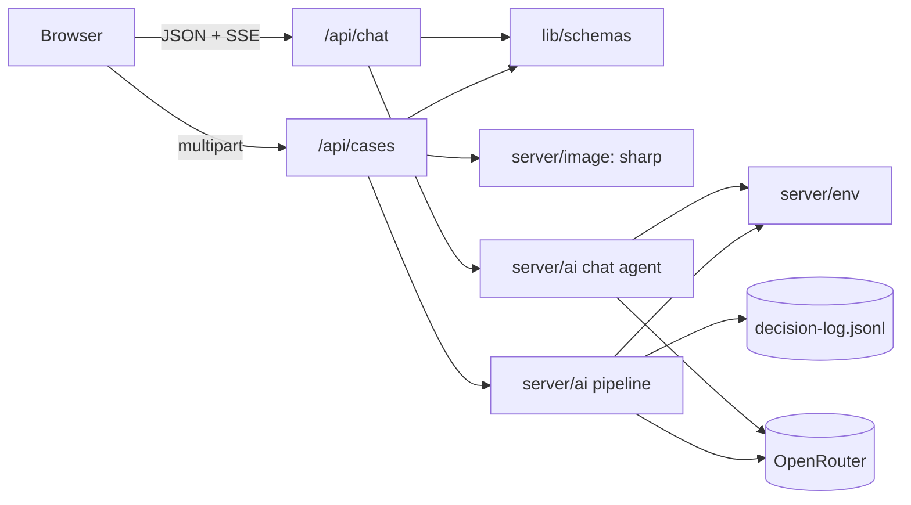
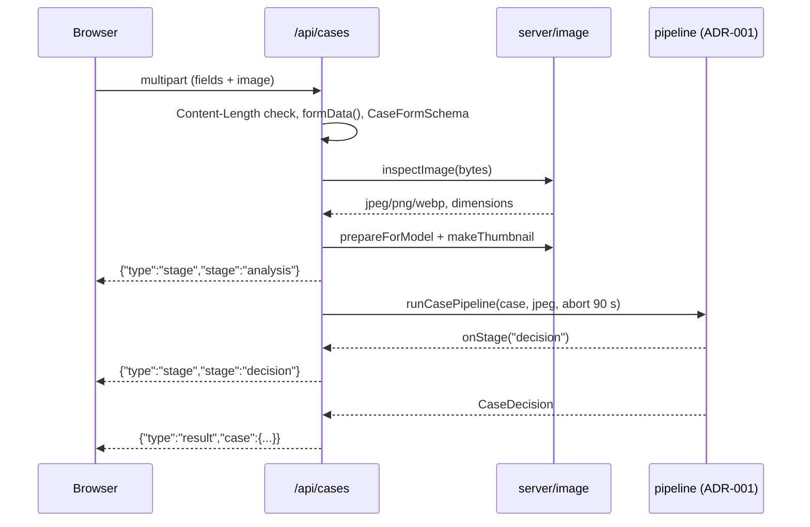
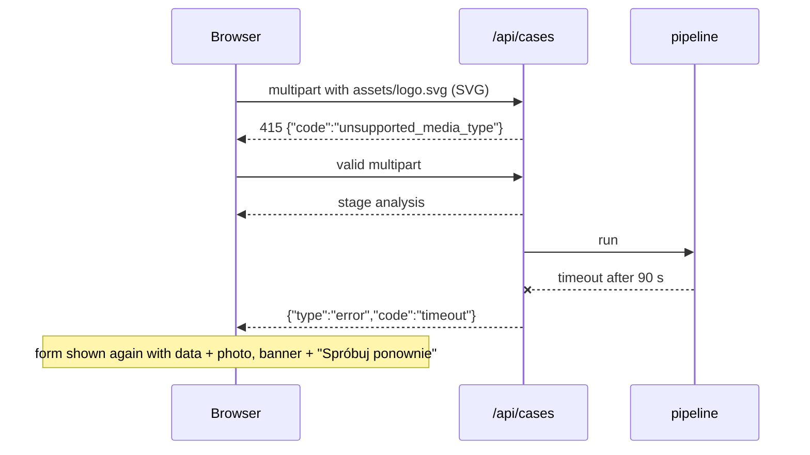
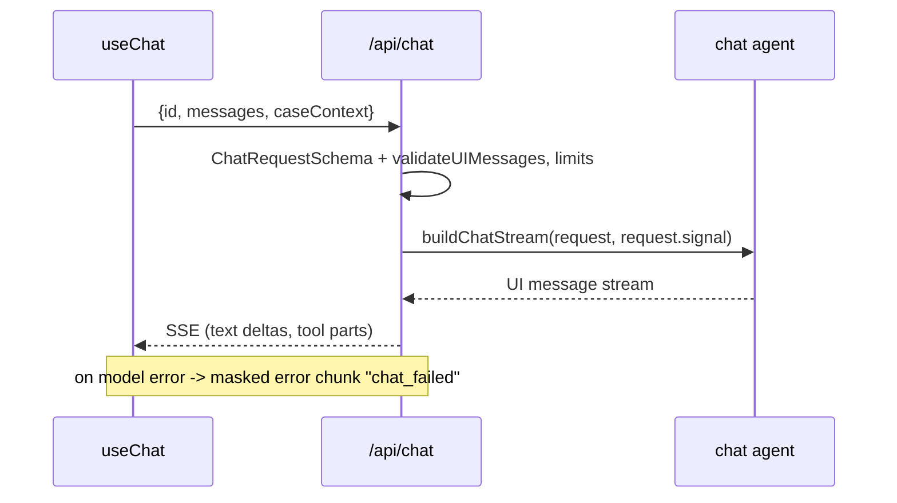

# ADR-002: Backend API and Image Processing

**Date:** 2026-11-25
**Status:** Accepted
**Relates to:** `docs/ADR/000-main-architecture.md`, `docs/ADR/001-ai-decision-pipeline.md`, `docs/PRD.md` (AC-01–AC-18, AC-32–AC-34, AC-40–AC-43)

---

## 1. Scope

Covers the two Next.js route handlers (`POST /api/cases`, `POST /api/chat`), shared validation schemas, image validation and compression, error model, timeouts, environment validation and server-side security rules.

Not covered: model prompts, routing and guards (ADR-001), UI (ADR-003), project setup (ADR-004).

---

## 2. Technology Documentation References

| Library | Context7 ID or official docs | Used for |
|---|---|---|
| Next.js 16 route handlers | `/vercel/next.js/v16.4.5` | `route.ts` handlers, `request.formData()`, streaming `Response`, `maxDuration`, `proxyClientMaxBodySize` |
| Vercel AI SDK 7 | `/vercel/ai/ai_7.0.0` | `createUIMessageStream`, `createUIMessageStreamResponse`, `toUIMessageStream`, `validateUIMessages`, `convertToModelMessages` |
| sharp | https://sharp.pixelplumbing.com/ | Format detection by content, EXIF auto-rotate, resize, JPEG/WebP encoding, metadata stripping, pixel limit |
| Zod 4 | https://zod.dev | Shared request schemas (client + server) |
| `server-only` | https://nextjs.org/docs/app/getting-started/server-and-client-components | Prevent server modules (API key) from being bundled for the client |

---

## 3. Component Design

| Module | Responsibility | Depends on |
|---|---|---|
| `lib/schemas` (shared) | Zod schemas: `CaseFormSchema` (fields + Polish error messages), `ChatRequestSchema`, `CaseContextSchema`, enums (case types, categories, decisions) | zod |
| `lib/i18n/pl` (shared) | All Polish UI/error strings, keyed by error code | — |
| `server/env` | Validates env vars at first import; fails fast with a clear message if `OPENROUTER_API_KEY` is missing | zod, `server-only` |
| `server/image` | `inspectImage` (detect format by content, dimensions), `prepareForModel` (rotate, resize, JPEG), `makeThumbnail` (small WebP data URL) | sharp |
| `server/ai/*` | ADR-001 pipeline, chat agent, policy loader, decision log | AI SDK, OpenRouter provider |
| `app/api/cases/route.ts` | Parse multipart, validate, preprocess, run pipeline, stream NDJSON progress + result | schemas, image, ai |
| `app/api/chat/route.ts` | Validate chat body, build and return the UI message stream | schemas, ai |

Rules: route handlers contain no business logic beyond orchestration; `server/*` modules import `server-only`; no `proxy.ts`/middleware matches `/api/cases` (Next 16 buffers proxied bodies only up to `proxyClientMaxBodySize`, default 10 MB, which a 10 MB photo plus multipart overhead exceeds). The server stores nothing between requests (PRD AC-40); the only file written is the decision log from ADR-001 3.7.

### Image processing rules
1. Reject if `Content-Length` > 11 MB before parsing (413), and if the file part > 10 MB (exactly 10 × 1024 × 1024 bytes) after parsing (413).
2. Detect the format from the bytes with sharp metadata; accept only `jpeg`, `png`, `webp` (AC-08: `laptop-1.png` is JPEG and is accepted). Anything else, or undecodable data, → 415.
3. Decode with a pixel limit of 50 megapixels (decompression-bomb guard) → 415 on violation.
4. **Model image:** auto-rotate by EXIF, resize to fit inside 1536 × 1536 px without enlargement (AC-14), encode JPEG quality 80, strip all metadata (removes GPS/EXIF personal data). If the result is > 1.5 MB, re-encode at quality 65. Sent to models as an in-memory buffer / base64 data URL (Luna Decisions accepts only base64 data URLs).
5. **Thumbnail:** 640 px longer edge, WebP quality 70, returned as a data URL (target ≤ 100 KB); shown scaled down in the case summary panel and at full size in the enlarge dialog; never sent to a model.
6. The original upload is discarded at the end of the request; nothing is written to disk.

---

## 4. Data Structures

### `CaseFormFields` (multipart text fields)
`caseType` (`return` | `complaint`), `category` (`laptop`, `smartphone`, `tablet`, `desktop`, `monitor`, `tv`, `audio`, `wearable`, `other`), `model` (trimmed, 2–100 chars), `purchaseDate` (`YYYY-MM-DD`, not in future, not older than 5 years — Europe/Warsaw "today"), `reason` (≤ 2000 chars; ≥ 20 trimmed when complaint), `consent` (must equal `true`), plus file part `image`.

### `CaseSessionPayload` (result returned to the client)
`caseId` (UUID v4), `createdAt`, `form` (all fields except the image), `thumbnailDataUrl`, `daysSincePurchase`, `decision` (`CaseDecision` from ADR-001 without `escalationReasons`, `guardsApplied` and raw probabilities), `firstMessage` (a ready UIMessage: assistant role, id `initial-<caseId>`, parts in this order: `text` (greeting), `data-decision`, `text` (body markdown) — PRD AC-21).

### `CaseContext` (sent by the client with each chat request)
`caseId`, `form`, `daysSincePurchase`, `imageFindings`, `signalsSummary`, `currentDecision` (decision + ruleRefs + source `initial` | `update`). No thumbnail.

### NDJSON progress events (`/api/cases` response body, one JSON object per line)
- `{ "type": "stage", "stage": "analysis" }` — image accepted, signals running
- `{ "type": "stage", "stage": "decision" }` — signals done, decision/writer running
- `{ "type": "result", "case": CaseSessionPayload }` — terminal
- `{ "type": "error", "code": "analysis_failed" | "model_unavailable" | "timeout" }` — terminal

---

## 5. Interface Contracts

### `POST /api/cases`
- **Input:** `multipart/form-data` with `CaseFormFields` + `image`.
- **Output (200):** `application/x-ndjson` stream of progress events ending with exactly one `result` or `error` event.
- **Pre-stream errors (JSON body `{ code, fieldErrors? }`):**
  - 400 `validation_failed` — `fieldErrors` maps field → error code (client shows Polish text from `lib/i18n/pl`)
  - 413 `file_too_large`
  - 415 `unsupported_media_type`
  - 500 `server_misconfigured` (missing env) — generic text to the user
- **Notes:** total pipeline time limited by an `AbortSignal` of 90 s (AC-18) → `error/timeout`; `maxDuration = 120`; the response never contains stack traces, provider names or HTTP codes of upstream calls (AC-43). No rate limiting (local PoC; see review trigger). Pipeline error mapping to NDJSON codes: `invalid_model_output` → `analysis_failed`, `model_unavailable` → `model_unavailable`, `timeout` → `timeout`.

### `POST /api/chat`
- **Input:** JSON `{ id, messages: UIMessage[], caseContext: CaseContext }`.
- **Validation:** `ChatRequestSchema` + AI SDK `validateUIMessages` (with the data-part schema for `decision` and the tool schema for `update_recommendation`); ≤ 60 messages; last message is from the user with 1–2000 characters of text (AC-32); body ≤ 512 KB → 400 `validation_failed` / 413.
- **Output:** UI message stream response (SSE) from `createUIMessageStreamResponse`; contains text parts and `tool-update_recommendation` parts; no reasoning parts.
- **Errors:** model/stream failures are masked by `onError` to the generic code `chat_failed`; the client shows "Nie udało się wysłać odpowiedzi." with "Ponów" (AC-42). Request aborted by the client (`stop()`/navigation) cancels the upstream call via `request.signal`.
- **Notes:** 60 s abort; `maxDuration = 90`. The server loads the policy itself from `caseContext.form.caseType`; it never accepts policy text or prompts from the client.

### Trust boundary
The server is stateless, so `caseContext` comes from the client and can be edited by the user. Accepted for the PoC because the result is advisory, anonymous and only visible to the same user; the case-type policy, prompts and guards are always server-side. A signed context token is the documented upgrade (review trigger below).

---

## 6. Technical Decisions

### One multipart endpoint with NDJSON progress for the first decision
**Status:** Accepted · **Date:** 2026-11-25
**Context:** The PRD shows a progress screen with staged statuses and returns to the form on failure (AC-41); the photo must reach the decision model and, on escalation, the reasoning LLM, without server storage.
**Decision:** `POST /api/cases` does preprocessing, signals and decision in one request and streams small NDJSON stage events, then the final JSON. The first message is not token-streamed; the chat page shows it complete.
**Rejected alternatives:**
- Two endpoints (`/analyze` then `/decide`): the photo would be uploaded twice or stored between calls (violates statelessness).
- Making the first decision the first `useChat` turn: puts the image into chat messages and sessionStorage, and failures land in the chat instead of the form.
- Server Actions: 1 MB default body limit; harder to stream progress.
**Consequences:** (+) honest progress, simple retry, one place for the 90 s budget; (−) client must parse NDJSON (small hand-written reader).
**Review trigger:** First-decision latency regularly > 30 s, making streaming the first message worth it.

### sharp for image validation and compression on the server
**Status:** Accepted · **Date:** 2026-11-25
**Context:** PRD requires server-side compression and content-based type detection; Luna Decisions takes base64 images only.
**Decision:** sharp (already a Next.js image dependency) for detection, rotation, resize, re-encode and metadata stripping.
**Rejected alternatives:** Client-side canvas resize only (cannot be trusted, PRD says BE compresses); `file-type` + separate resize lib (two dependencies for what sharp does).
**Consequences:** (+) one native dependency, strips EXIF/GPS; (−) native binary must install on the VM (pnpm `allowBuilds`/`onlyBuiltDependencies` for sharp).
**Review trigger:** Deployment to a platform where native modules are unavailable.

### Stateless server, client-held case context
**Status:** Accepted · **Date:** 2026-11-25
**Context:** No database in the PoC (PRD §7, AC-40); chat needs full context every turn.
**Decision:** The client sends `caseContext` + full message history on every chat request.
**Rejected alternatives:** In-memory server session map — lost on restart, breaks refresh restore across `next dev` reloads, and is "stored case data".
**Consequences:** (+) no persistence layer; (−) user can tamper with context; request size grows with history (bounded by the 60-message cap).
**Review trigger:** Adding the deferred database (PRD Further Notes 1–2) or any non-advisory use of decisions.

---

## 7. Diagrams

### Component diagram

### Sequence — `POST /api/cases` happy path

### Sequence — validation and failure paths

### Sequence — `POST /api/chat`

---

## 8. Testing Strategy

### Test scenarios for this area

| Scenario | Type | Input | Expected output | Edge cases |
|---|---|---|---|---|
| Form schema | Unit | valid and invalid field sets | per-field error codes | complaint reason 19 vs 20 chars trimmed; model 1/2/100/101 chars; date today, tomorrow, 5 years ago ± 1 day |
| Content-based type | Unit | each file in `assets/example-images/` | all accepted; `laptop-1.png` detected as jpeg | `assets/logo.svg` (real file of a disallowed type) → 415; PDF/GIF/HEIC/truncated files are documented gaps (no real samples; generated files are forbidden) |
| Size limit | Unit (size check runs before decoding, so no image is needed) + Integration (Content-Length header) | byte length exactly 10 MB vs 10 MB + 1 byte | accept / 413 | missing Content-Length. Upload tests use only the real photos from `assets/example-images/`, never generated images (see its README) |
| Compression | Unit | 3024×3135 `laptop-1.png`, 387×516 `phone-2.jpeg` | longest edge 1536 / unchanged 516; JPEG; no EXIF | ≤ 1.5 MB output |
| Thumbnail | Unit | example photos | WebP data URL ≤ 100 KB, longest edge 640 | tiny image not enlarged |
| `/api/cases` stream | Integration (recorded OpenRouter replays, ADR-006) | valid request | stage analysis → stage decision → result; payload matches schema | pipeline throws → error event; abort → timeout event |
| `/api/cases` errors | Integration | invalid fields | 400 with field codes, no model call | consent false |
| `/api/chat` validation | Integration | 61 messages, 2001-char message, empty text, unknown data part | 400 | body > 512 KB → 413 |
| `/api/chat` stream | Integration (recorded chat stream replay) | valid request | SSE with text parts, no reasoning parts | model error → masked `chat_failed` |
| No error leakage | Integration | recorded 401 response with provider error body; real connection failure | client-visible output has only code | — |
| Env validation | Unit | missing key | clear startup error | — |

### Technical acceptance criteria

- TAC-002-01: Every route handler response for invalid input is produced without calling any model (asserted with call counters on the recorded-replay model doubles).
- TAC-002-02: The model image for every example photo has its longer edge ≤ 1536 px, is JPEG and has no EXIF block.
- TAC-002-03: `/api/cases` emits exactly one terminal event (`result` or `error`) per request.
- TAC-002-04: No response body or server log line contains `OPENROUTER_API_KEY`, base64 image data or stack traces.
- TAC-002-05: `server/*` modules fail the build if imported from a client component (`server-only`).
