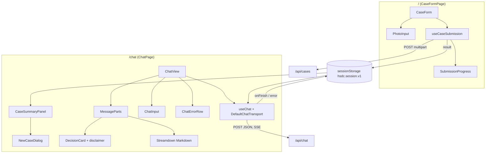
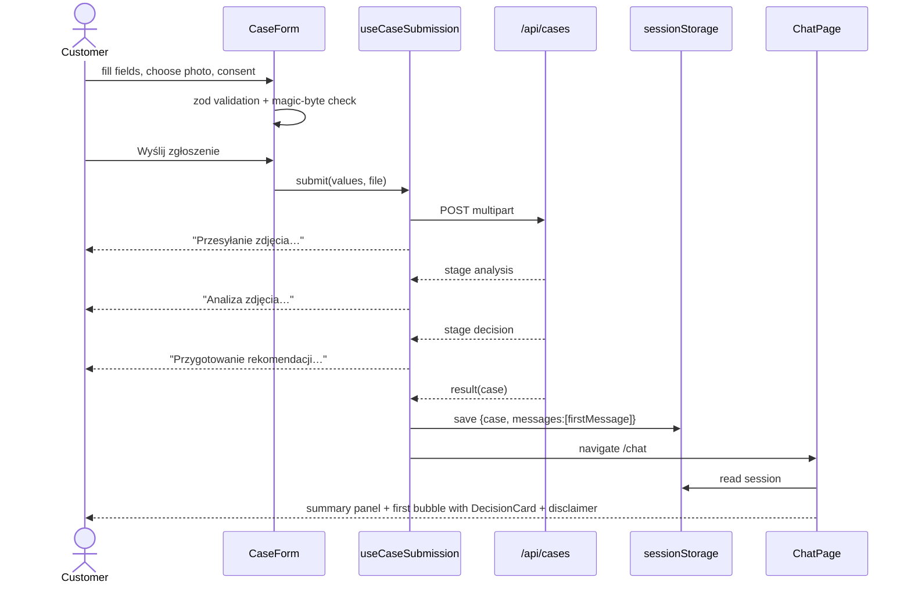
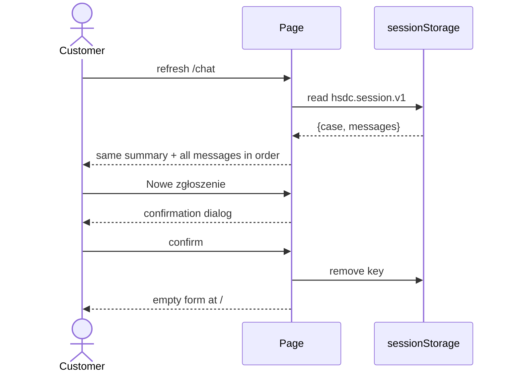
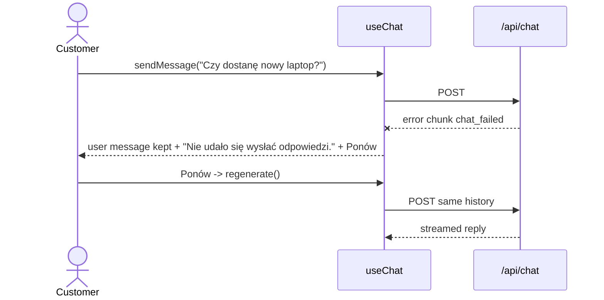

# ADR-003: Frontend — Form, Chat UI and Browser Session

**Date:** 2026-11-25
**Status:** Accepted
**Relates to:** `docs/ADR/000-main-architecture.md`, `docs/ADR/002-backend-api.md`, `docs/PRD.md` (sections 6 "Form", "Disclaimer", "Chat", "Session", 9), `docs/design-guidelines.md`

---

## 1. Scope

Covers pages, client components, the chat UI built from shadcn AI Elements patterns, rendering of decision cards, the `useChat` integration with `/api/chat`, the sessionStorage session, accessibility and brand theming.

Not covered: server logic (ADR-001/002), scaffolding commands (ADR-004).

---

## 2. Technology Documentation References

| Library | Context7 ID or official docs | Used for |
|---|---|---|
| AI SDK UI (`@ai-sdk/react` 4.x) | `/vercel/ai/ai_7.0.0` | `useChat`, `DefaultChatTransport`, `prepareSendMessagesRequest`, typed `UIMessage`, `regenerate`, `stop` |
| shadcn/ui AI Elements (new home) | https://ui.shadcn.com/docs/ai-elements (agents: use the `.md` pages, e.g. `/docs/ai-elements/base/chat.md`) | Chat (message scroller), Message, Bubble, Prompt Input patterns |
| AI Elements (legacy registry, deprecated end of Nov 2026) | `/vercel/ai-elements` | Reference only; do **not** install from `elements.ai-sdk.dev` |
| shadcn/ui | https://ui.shadcn.com/docs | Form field primitives, Button, Dialog, Alert, Checkbox, Select, Collapsible |
| shadcn `@shadcn/helpers/ai-sdk` | https://ui.shadcn.com/docs/helpers/ai-sdk | Not used for tests: scripted streams are not recordings (ADR-006 §3.1) |
| Streamdown 2.x | https://streamdown.ai/docs | Streaming-safe Markdown rendering (used by the Message pattern) |
| React Hook Form + zod resolver | https://ui.shadcn.com/docs/forms/react-hook-form | Form state and validation with the shared `CaseFormSchema` |
| Next.js 16 App Router | `/vercel/next.js/v16.4.5` | Pages, `next/font`, client components |
| Tailwind CSS 4 | https://tailwindcss.com/docs | `@theme` tokens mapped from `assets/design-tokens.json` |

---

## 3. Component Design

### 3.1 Routes

| Route | Component | Behavior |
|---|---|---|
| `/` | `CaseFormPage` | If a stored session exists → client redirect to `/chat` (PRD 4.7). Otherwise the form, the progress view and the error banner. |
| `/chat` | `ChatPage` | If no stored session → redirect to `/`. Otherwise case summary + conversation. |

Both pages are client-rendered for their interactive parts (sessionStorage is browser-only); layouts and static header are server components. Hydration must not flash the wrong screen: render a neutral loading shell until the session check runs.

### 3.2 Components

| Component | Responsibility |
|---|---|
| `CaseForm` | Fields in AC-01 order; React Hook Form with the shared zod schema; dynamic required marker, placeholder and photo hint per case type; native `<input type="date">` with `max` = today and `min` = today − 5 years; live counter for reason; focus to first invalid field (AC-12). |
| `PhotoInput` | One file; `accept="image/jpeg,image/png,image/webp"` + `capture` option on mobile (gallery or camera); client checks size ≤ 10 MB and magic bytes (JPEG `FF D8 FF`, PNG `89 50 4E 47`, WebP `RIFF….WEBP`) so content, not extension, decides (AC-08/09); thumbnail via object URL; "Zmień zdjęcie". |
| `SubmissionProgress` | Status text sequence: "Przesyłanie zdjęcia…" until the first NDJSON event, then "Analiza zdjęcia…", "Przygotowanie rekomendacji…"; `aria-live="polite"`. |
| `useCaseSubmission` | Builds `FormData`, posts to `/api/cases`, reads the NDJSON stream line by line, maps codes to Polish texts, keeps the `File` and form values in memory for retry (AC-41), prevents double submission (AC-13). |
| `CaseSummaryPanel` | Type, category, model, purchase date, days since purchase, thumbnail (click → dialog with larger image), current decision badge, "Nowe zgłoszenie". Collapsible on mobile, collapsed by default (PRD 9.3). |
| `ChatView` | AI Elements Chat/Message Scroller (auto-scroll to newest, AC-37), message list with `role="log"`, prompt input. |
| `MessageParts` | Renders parts in their order (first message: greeting `text` → `data-decision` → body `text`, PRD AC-21). Switch over `message.parts`: `text` → Markdown (Streamdown, raw HTML disabled); `data-decision` → `DecisionCard(kind="initial")`; `tool-update_recommendation` with output available → `DecisionCard(kind="update")`; tool input in progress → "Aktualizuję rekomendację…"; `reasoning`/`reasoning-file`/unknown → render nothing. |
| `DecisionCard` | Badge with text + icon per decision (Akceptacja ✓ / Odrzucenie ✕ / Weryfikacja ręczna ?), never colour-only; label "Zaktualizowana rekomendacja" with previous → new for updates; rule references; **fixed disclaimer text from `lib/i18n/pl` attached inside the card** (AC-29/30). |
| `ChatInput` | AI Elements Prompt Input: 1–2000 chars, Enter sends, Shift+Enter newline (AC-32), counter shown from 1800 chars, disabled while `status` is `submitted`/`streaming` (AC-33). |
| `ChatErrorRow` | On `status === "error"`: "Nie udało się wysłać odpowiedzi." + "Ponów" → `regenerate()` (no duplicate user message, AC-42). |
| `NewCaseDialog` | Confirmation text from PRD 4.7; on confirm clears session and navigates to `/`. |
| `sessionStore` | Typed read/write/clear of the session in sessionStorage (3.3). |

### 3.3 Browser session (sessionStorage)

- Key `hsdc.session.v1`; value `{ version: 1, case: CaseSessionPayload, messages: UIMessage[] }`. sessionStorage is per tab and survives refresh, matching PRD 4.7 exactly (not shared across tabs or devices).
- Written: right after a successful `/api/cases` result (messages = `[case.firstMessage]`), and in `useChat` `onFinish` (not on every token). Also written when `status` turns `error`, so the user's message survives a refresh.
- Read: once on page load; invalid JSON or wrong version → cleared and treated as no session.
- Size budget: thumbnail ≤ 100 KB + messages; on `QuotaExceededError` show a non-blocking notice "Nie udało się zapisać rozmowy w przeglądarce." and keep working.
- The case form draft is **not** persisted (only kept in memory for retry).
- The **current decision** is derived, not stored separately: the last `DecisionCard`-producing part in `messages` (initial data part or latest successful tool output).

### 3.4 `useChat` integration

- Typed message: `UIMessage<never, { decision: DecisionData }, { update_recommendation: … }>` shared with the server.
- `useChat({ id: case.caseId, messages: storedMessages, transport: new DefaultChatTransport({ api: "/api/chat", prepareSendMessagesRequest }) })`. `prepareSendMessagesRequest` sends `{ id, messages, caseContext }`, where `caseContext` is built from the stored case + current decision at request time (never stale hook-level body).
- The first message is inserted as an ordinary assistant `UIMessage` (from `/api/cases`), so it is the first bubble (AC-31) and part of the history the server converts for the model (AC-34).
- Template parts that do not apply are removed: model selector, AI Gateway model list, web search / GitHub tools, trace UI.

### 3.5 Brand and theming

- `assets/design-tokens.json` → Tailwind 4 `@theme` variables and the shadcn semantic variables (`--background` ← `--surface`, `--primary` ← `--accent`, `--card` ← `--surface-raised`, etc.) in the global CSS; components use tokens, never raw hex (design-guidelines).
- Fonts Bangers (display) and Atkinson Hyperlegible (body) through `next/font/google`.
- Chat bubbles: user `--chat-client` with `radius.bubbleClient`; agent `--chat-agent` with `radius.bubbleAgent`; 3 px ink borders and offset shadows from the tokens.
- Light theme only in the PoC; dark tokens are defined so a later toggle needs no component changes.
- Logo and favicon from `assets/` copied into the app's public folder at setup.

---

## 4. Data Structures

- `DecisionData` (data part payload): `decision`, `ruleRefs`, `kind` (`initial`), `remedy` (nullable).
- `UpdateRecommendationOutput`: as ADR-001 4.6.
- `StoredSession`: see 3.3.
- `SubmissionState`: `idle` | `submitting(stage)` | `error(code)`; values + `File` held in component state.

---

## 5. Interface Contracts

- Consumes `POST /api/cases` and `POST /api/chat` exactly as defined in ADR-002.
- Exposes no API. All user-facing strings come from `lib/i18n/pl` (single source for UI tests and AC-44).

---

## 6. Technical Decisions

### shadcn AI Elements patterns + `useChat`, starting from `shadcn-ui/chatbot-template`
**Status:** Accepted · **Date:** 2026-11-25
**Context:** We need streaming chat components that we can fully restyle to the comic-style brand, plus a custom decision card and a form-first flow without auth or DB.
**Decision:** Use AI SDK UI `useChat` with AI Elements patterns from their new shadcn/ui home, as already wired in `shadcn-ui/chatbot-template` (see ADR-004). Components are copied source, styled with our tokens; Streamdown renders Markdown.
**Rejected alternatives:**
- **Chat SDK (chat-sdk.dev):** now a multi-platform bot SDK (Slack, Teams, …), not a web chat app template.
- **vercel/chatbot (former ai-chatbot):** requires Auth.js, Postgres, Blob, Redis and AI Gateway — all out of scope; stripping costs more than building.
- **assistant-ui:** capable (MIT) but pre-1.0, its AI SDK 7 adapter is at 0.0.x, and its thread model adds indirection for the custom decision card.
- **Legacy AI Elements registry (elements.ai-sdk.dev):** deprecated at the end of November 2026.
- **Hand-written components only:** more code with no benefit over copied patterns.
**Consequences:** (+) full styling control, minimal runtime dependencies, streaming Markdown and auto-scroll ready; (−) copied code is ours to maintain; the new shadcn AI Elements location is recent, so pattern names may still change.
**Review trigger:** shadcn changes the AI Elements pattern API, or branding requirements cannot be met by editing the copied components.

### Native date input instead of a calendar popover
**Status:** Accepted · **Date:** 2026-11-25
**Context:** One date with simple min/max rules; customers are often on phones.
**Decision:** `<input type="date">` styled with tokens.
**Rejected alternatives:** shadcn Calendar + Popover — more code and keyboard/screen-reader work for no functional gain.
**Consequences:** (+) native mobile pickers, keyboard accessible (AC-46); (−) desktop look varies by browser.
**Review trigger:** Design review rejects the native look.

### sessionStorage as the only session store
**Status:** Accepted · **Date:** 2026-11-25
**Context:** User chose "keep in browser"; PRD says same tab, survives refresh.
**Decision:** sessionStorage with a versioned key; the server stays stateless.
**Rejected alternatives:** localStorage — survives tab close and shares between tabs (violates PRD 4.7.3); IndexedDB — unnecessary complexity for < 1 MB.
**Consequences:** (+) zero backend; (−) closing the tab loses the case (accepted in PRD).
**Review trigger:** Server persistence (deferred feature) is added.

---

## 7. Diagrams

### Component diagram

### Sequence — form to chat

### Sequence — refresh restore and new case

### Sequence — chat error and retry

---

## 8. Testing Strategy

Component tests use Vitest + Testing Library (jsdom); `useChat` and submission tests use a replay transport/fetch double that streams **recorded** `/api/chat` and `/api/cases` bodies from `tests/fixtures/app/` (ADR-006 §3.1) — no network, no scripted or hand-written streams. E2E uses Playwright against the real app (ADR-000).

| Scenario | Type | Input | Expected output | Edge cases |
|---|---|---|---|---|
| Field order and options | Component | render form | AC-01 order; AC-02/03 options, none preselected | — |
| Reason required by type | Component | switch Zwrot ↔ Reklamacja | required marker and validation change | 19/20 chars trimmed |
| Photo validation | Unit (pure checks) + Component | size check on a byte count (10 MB vs 10 MB + 1); magic-byte check on header bytes read from the real example photos and `assets/logo.svg`; component test uploads real example photos and `assets/logo.svg` | Polish errors; `laptop-1.png` (JPEG bytes) accepted; `logo.svg` rejected | replace photo; no generated or empty files |
| Invalid submit | Component | empty form | no fetch call; errors under fields; focus on first | — |
| Double submit | Component | double click | one request | — |
| NDJSON reader | Unit | chunked lines split mid-JSON | correct events in order | trailing newline missing |
| Failure keeps data | Component | recorded error event (run with invalid key) | form with same values + photo, banner, retry resends | timeout code |
| DecisionCard | Component | each decision, initial/update | text + icon, exact disclaimer string | update shows previous → new |
| Parts switch | Component | message with reasoning + unknown parts | nothing rendered for them | — |
| Session store | Unit | save/read/clear, corrupt JSON, quota error | typed result / cleared / notice | version mismatch |
| Refresh restore | E2E | reload `/chat` | same messages | — |
| Chat retry | Component (recorded masked-failure then recorded reply) | send → error → Ponów | one user message, assistant reply appears | — |
| Keyboard | Component | Enter / Shift+Enter | send / newline | IME composition |
| Responsive | E2E | 360 px and 1440 px | no horizontal scroll; summary collapsed on mobile | — |

### Technical acceptance criteria

- TAC-003-01: The disclaimer string rendered in every `DecisionCard` equals the constant in `lib/i18n/pl` (single source) — asserted in component tests for all 3 decisions × 2 kinds.
- TAC-003-02: No component renders `reasoning` or `reasoning-file` parts.
- TAC-003-03: After `onFinish`, sessionStorage contains all messages; a reload reproduces the same rendered message list (E2E).
- TAC-003-04: `document.documentElement.scrollWidth ≤ window.innerWidth` at 360 px on both pages (E2E).
- TAC-003-05: Lighthouse/axe automated accessibility check reports no "serious" or "critical" issues on both pages (E2E with axe).
