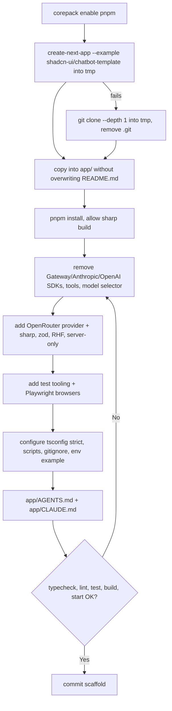
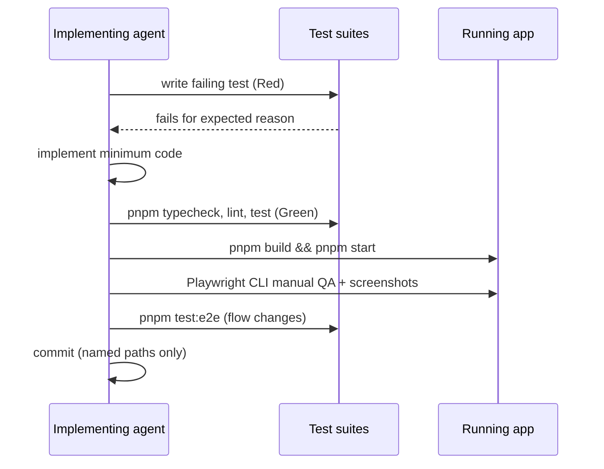

# ADR-004: Project Initialization, Tooling and Agent Instructions

**Date:** 2026-11-25
**Status:** Accepted
**Relates to:** `docs/ADR/000-main-architecture.md`

---

## 1. Scope

How the implementing agent initializes the empty `app/` folder, which starter template is used and what is removed from it, package manager and runtime, TypeScript and lint configuration, test tooling, scripts, environment files, and the nested agent instructions for `app/`.

Not covered: application behavior (ADR-001–003).

---

## 2. Technology Documentation References

| Library / tool | Context7 ID or official docs | Used for |
|---|---|---|
| `shadcn-ui/chatbot-template` | https://github.com/shadcn-ui/chatbot-template | Starter: Next.js 16, `ai` ^7, `@ai-sdk/react` ^4, Tailwind 4, shadcn 4, AI Elements wired to `useChat` |
| create-next-app | `/vercel/next.js/v16.4.5` (CLI reference: https://nextjs.org/docs/app/api-reference/cli/create-next-app) | `--example <github-url>`, `--use-pnpm`, `--disable-git`, `--skip-install` |
| shadcn CLI | https://ui.shadcn.com/docs/cli | `shadcn add` for extra AI Elements and form patterns |
| shadcn MCP server (optional for agents) | https://ui.shadcn.com/docs/mcp | Agent lookup of registry components |
| AI SDK 7 migration guide | `/vercel/ai/ai_7.0.0` | v7 names cheat-sheet for `app/AGENTS.md` |
| Vitest | https://vitest.dev | Unit + integration + component tests |
| Testing Library | https://testing-library.com/docs/react-testing-library/intro | Component tests |
| Playwright Test | https://playwright.dev/docs/intro | E2E against the real stack |
| pnpm / Corepack | https://pnpm.io/installation | Package manager pinned through `packageManager` |

Verified 2026-11-25: Node on the course VM is v24.22.3 (LTS); pnpm is **not installed** on the VM; Next.js stable 16.4.6 (requires Node ≥ 20.9); `ai` 7.x requires Node ≥ 22 and is ESM-only.

---

## 3. Component Design

### 3.1 Initialization sequence (non-interactive, run from the repository root)

1. **pnpm:** per ADR-005 §3.1 — `corepack enable --install-directory ~/.local/bin pnpm` (plain `corepack enable` needs root on the VM); fallback `corepack pnpm …`. Verify with `pnpm --version`.
2. **Scaffold into a temporary directory** (create-next-app refuses a non-empty folder; `app/README.md` must be preserved):
   `pnpm create next-app@latest <tmp>/app --example https://github.com/shadcn-ui/chatbot-template --use-pnpm --disable-git --skip-install`
   Fallback if `--example` fails: shallow `git clone` of the same repository into `<tmp>/app` and delete its `.git`.
3. **Merge into `app/`:** no-clobber copy of the template into `app/` (`cp -an <tmp>/app/. app/`), so the existing `app/README.md` is kept; copy useful setup notes from `<tmp>/app/README.md` into `app/README.md` by hand (keep its checklist). The temporary directory stays outside the repository (`rm` is denied by settings).
4. **Install:** `pnpm install` inside `app/`; allow the native build of `sharp` in pnpm settings.
5. **Swap the model gateway for OpenRouter:** remove `@ai-sdk/gateway`, `@ai-sdk/anthropic`, `@ai-sdk/openai`; add `@openrouter/ai-sdk-provider@^3.1.0`. Replace string model IDs / Gateway calls with the OpenRouter provider; delete the model selector, model list, `web_search` and `github_repo` tools, trace UI and any Vercel OIDC / `vercel env pull` references.
6. **Add dependencies:** `sharp`, `zod` (v4), `server-only`, `react-hook-form`, `@hookform/resolvers`; dev: `vitest`, `@vitejs/plugin-react`, `jsdom`, `@testing-library/react`, `@testing-library/user-event`, `@testing-library/jest-dom`, `@playwright/test`, `@axe-core/playwright`, `tsx`. Then `pnpm exec playwright install chromium`.
7. **Add shadcn patterns as needed** (`pnpm dlx shadcn@latest add …`): form/field, select, checkbox, dialog, alert, collapsible, plus any AI Elements pattern not already in the template (e.g. prompt input). Always from the shadcn registry, never from the deprecated `elements.ai-sdk.dev` registry.
8. **Configure** (3.2–3.5), then run `pnpm typecheck && pnpm lint && pnpm test && pnpm build` and start the app once before the first commit. Commit the scaffold separately (`App: scaffold from shadcn chatbot-template with OpenRouter`).

### 3.2 Repository layout inside `app/`

The template uses the Next.js root-level `app/` router directory, so routes live in `app/app/…` (the outer `app/` is the course project folder). Expected top-level layout after setup:

| Path (inside `app/`) | Content |
|---|---|
| `app/` | Routes: `page.tsx` (form), `chat/page.tsx`, `api/cases/route.ts`, `api/chat/route.ts`, `layout.tsx`, global CSS |
| `components/` | `ai-elements/` and `ui/` (shadcn copies), feature components (`case-form/`, `chat/`, `decision-card/`) |
| `lib/` | Shared: `schemas/`, `i18n/pl`, `session-store`, `ndjson` reader, types |
| `server/` | Server-only: `env`, `image/`, `ai/` (pipeline, decisions adapter, chat agent, prompts/, policy loader, decision log) |
| `scripts/` | `eval-decisions.ts` |
| `tests/` | `unit/`, `integration/`, `e2e/`, `fixtures/openrouter/` and `fixtures/app/` (recorded real responses with capture metadata, ADR-006), `fixtures/GAPS.md` |
| `public/` | Logo and favicon copied from `../assets/` |
| `.data/` | Decision log (git-ignored) |

If the template already uses different folder names, keep its conventions and map these roles onto them; record the mapping in `app/AGENTS.md`.

### 3.3 Configuration

- `package.json`: `"packageManager": "pnpm@<installed version>"`, `"engines": { "node": ">=24" }`; scripts `dev`, `build`, `start`, `lint`, `typecheck` (`tsc --noEmit`), `test` (Vitest run), `test:watch`, `test:e2e` (Playwright), `eval:decisions`, `openrouter:status`, `record:openrouter`, `record:app` (tsx scripts, ADR-006). All entries are registered in T04 even when the script file is created later, so workers never edit `package.json`.
- `tsconfig.json`: `"strict": true` (verify — not confirmed in the template), plus `"noUncheckedIndexedAccess": true`; path alias `@/*`.
- ESLint: keep the template config; zero warnings policy for changed files.
- Vitest: two projects — `node` (server, schemas, pipeline) and `jsdom` (components); `tests/e2e` excluded.
- Playwright: `webServer` runs `pnpm build && pnpm start` on port 3000; projects: Desktop Chrome 1440 px and a 360 px mobile viewport; test timeout 120 s (real model calls).
- `.gitignore`: `.env*.local`, `.data/`, `test-results/`, `playwright-report/`, `.next/`.

### 3.4 Environment files

- `app/.env.example` lists every variable from ADR-000 §7 with example values; the real values go into `app/.env.local` (git-ignored). The root `.env.example` stays as the course-level reference and gains the new variables too.

### 3.5 Agent instructions (nested)

- `app/AGENTS.md` — created from the template's / Next.js's generated agent file, trimmed and extended with: the exact pnpm commands above; the folder role map (3.2); an **AI SDK 7 cheat-sheet** (`instructions` not `system`, `Output.object` instead of `generateObject`, `createUIMessageStreamResponse` + `toUIMessageStream` instead of `result.toUIMessageStreamResponse()`, file parts with `mediaType`, `MockLanguageModelV4` from `ai/test`, `onEnd` not `onFinish` for core calls); "use Context7 `/vercel/ai/ai_7.0.0` and match the lockfile version"; the OpenRouter-only rule (no Gateway); "upload tests use only `../assets/example-images/`".
- `app/CLAUDE.md` contains `@AGENTS.md` (same pattern as the root).
- The template's own `.claude/` directory is reviewed: keep nothing that conflicts with root rules (commit, TDD, Manual QA); delete the rest.
- The root `AGENTS.md` stays short and universal; only a one-line pointer to `app/AGENTS.md` is added there.

---

## 4. Data Structures

Not applicable (tooling ADR).

---

## 5. Interface Contracts

Commands the implementing and reviewing agents rely on (run inside `app/`):

| Command | Purpose | Must pass before commit |
|---|---|---|
| `pnpm typecheck` | TS strict | Yes |
| `pnpm lint` | ESLint | Yes |
| `pnpm test` | Unit + integration + component (no network) | Yes |
| `pnpm build` | Production build | Yes, for runtime changes |
| `pnpm test:e2e` | Real stack incl. OpenRouter (needs `OPENROUTER_API_KEY`) | Yes, for flow changes |
| `pnpm dev` / `pnpm start` | Manual QA with Playwright CLI | Yes (AGENTS.md Manual QA) |
| `pnpm eval:decisions` | Fast-path vs escalation evaluation | No (manual, costs credits) |

---

## 6. Technical Decisions

### Start from `shadcn-ui/chatbot-template`
**Status:** Accepted · **Date:** 2026-11-25
**Context:** The user asked for the most advanced fitting boilerplate that already wires the AI SDK and `useChat`, so the agent does not configure them by hand.
**Decision:** Use `shadcn-ui/chatbot-template` (checked 2026-11-25: `ai` ^7.0.118, `@ai-sdk/react` ^4.0.121, `next` 16.3.6, Tailwind 4, shadcn ^4.21, last commit 2026-10-15, standalone — no `workspace:*`, no auth/DB/blob). It is the starter the shadcn AI Elements docs point to and includes a hardened streaming route (`validateUIMessages`, abort signal, `maxDuration`).
**Rejected alternatives:**
- Plain `create-next-app` + `shadcn init` + manual AI SDK wiring: viable fallback but repeats work the template already did.
- `vercel/ai` repository examples: depend on `workspace:*` (not standalone), Tailwind 3 / React 18 in `examples/next`; `examples/next-openai` no longer exists.
- vercel/chatbot: needs Auth.js, Postgres, Blob, Redis, AI Gateway.
- Next.js AI Lite and other gallery templates: outdated (`ai` 3.x) or tied to one provider / AI Gateway.
- No official OpenRouter Next.js starter exists (OpenRouter quickstart is plain Node).
**Consequences:** (+) working `useChat` + streaming + AI Elements from minute one; (−) template cleanup step (Gateway, tools, selector) and its `next` pin 16.3.6 should be bumped to current 16.4.x after the first green build.
**Review trigger:** Template is archived, or its next release changes the chat route structure substantially.

### pnpm via Corepack, Node 24 LTS
**Status:** Accepted · **Date:** 2026-11-25
**Context:** User chose pnpm; pnpm is missing on the VM; AI SDK 7 needs Node ≥ 22.
**Decision:** Enable pnpm with a user-level Corepack shim (ADR-005 §3.1), pin it in `packageManager`; require Node ≥ 24 (installed v24.22.3).
**Rejected alternatives:** Global `npm i -g pnpm` (unpinned version); Node 26 upgrade (not needed).
**Consequences:** (+) reproducible tool version; (−) Corepack must be enabled once per VM.
**Review trigger:** Corepack removed from the Node version in use.

### Nested `app/AGENTS.md` with an AI SDK 7 cheat-sheet
**Status:** Accepted · **Date:** 2026-11-25
**Context:** Models trained on AI SDK v5/v6 examples generate deprecated APIs; the root `AGENTS.md` must stay universal.
**Decision:** Stack-specific rules live in `app/AGENTS.md` (+ `app/CLAUDE.md` importing it).
**Rejected alternatives:** Putting stack rules in the root file (bloats context for docs-only work); no instructions (repeated v6 mistakes).
**Consequences:** (+) scoped, short instructions loaded only when working in `app/`; (−) two files to keep consistent.
**Review trigger:** Upgrade to a new AI SDK major.

---

## 7. Diagrams

### Initialization flow

### Sequence — agent verification loop per task

---

## 8. Testing Strategy

### Test scenarios for this area

| Scenario | Type | Input | Expected output | Edge cases |
|---|---|---|---|---|
| Fresh scaffold builds | Smoke | after 3.1 steps | typecheck, lint, build pass; `pnpm start` serves `/` with HTTP 200 | missing `.env.local` → clear error only when an API route is called |
| No Gateway leftovers | Static check | grep for `@ai-sdk/gateway`, `AI_GATEWAY_API_KEY`, `vercel env` | no matches in `app/` | — |
| Strict TS | Static check | `tsconfig.json` | `strict: true`, `noUncheckedIndexedAccess: true` | — |
| Test runner wiring | Smoke | one sample unit, component and E2E test | each runner discovers and runs ≥ 1 test, reported counts | — |

### Technical acceptance criteria

- TAC-004-01: `pnpm install --frozen-lockfile` succeeds on a clean clone with Node 24 and Corepack-enabled pnpm.
- TAC-004-02: `pnpm typecheck && pnpm lint && pnpm test && pnpm build` exit with code 0 and no warnings introduced by the scaffold commit.
- TAC-004-03: `app/README.md` content from before the scaffold is still present after the merge.
- TAC-004-04: No file in `app/` references AI Gateway, Anthropic or OpenAI provider packages.
- TAC-004-05: `app/AGENTS.md` exists, is under 150 lines and contains the verification commands table and the AI SDK 7 cheat-sheet.
